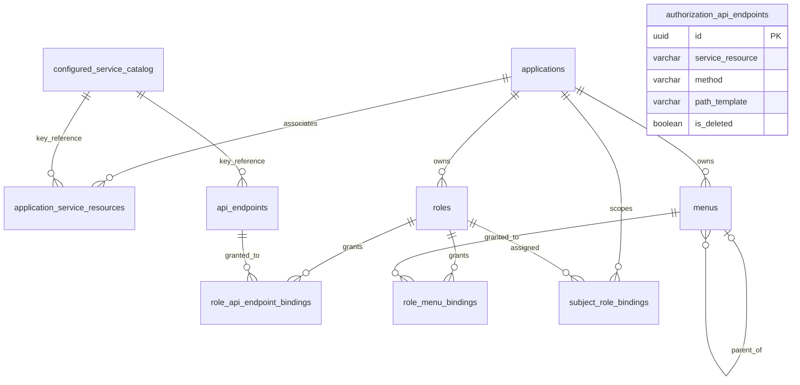

# 当前数据库结构

整理日期：2026-10-15。

[返回当前功能总览](current-system-overview.md) · [完整初始化 SQL](../migrations/001_init.sql)

本文档按 `migrations/001_init.sql` 逐项整理，本次没有对运行中的数据库进行结构比对。该脚本是空数据库的纯初始化脚本：只创建扩展、枚举、表、约束、触发器和索引，不插入种子数据，也不执行升级或替换操作。

文档中的“允许 NULL”以列声明为准；“默认值”是脚本中的 PostgreSQL 表达式或字面量。`updated_at` 只有插入时的 `DEFAULT NOW()`，脚本没有自动更新时间触发器；唯一的自动更新字段是 `applications.policy_token`。

## 枚举类型

| 枚举 | 值 | 用途 |
| --- | --- | --- |
| `service_resource_source` | `local`、`nexusauth` | 服务资源来源 |
| `endpoint_source` | `manual`、`swagger` | API 端点登记来源 |
| `menu_type` | `directory`、`menu`、`button` | 菜单节点类型 |

## 表结构

### `service_resources`

服务资源目录。当前表只允许持久化 `local` 资源；`service_resource_source` 保留 `nexusauth` 枚举值用于兼容，但表级 CHECK 要求 `source = 'local' AND external_id IS NULL`。NexusAuth 资源只由配置的远程目录提供，数据库不持久化远程元数据。API 端点和应用关联通过 `resource_key` 做逻辑关联，不建立指向本表的外键。

| 字段 | 实际 PostgreSQL 类型（长度） | 允许 NULL | 默认值 | 含义 |
| --- | --- | --- | --- | --- |
| `id` | `UUID` | 否 | `gen_random_uuid()` | 服务资源主键 |
| `resource_key` | `VARCHAR(128)` | 否 | 无 | 稳定的服务资源标识 |
| `display_name` | `VARCHAR(200)` | 否 | 无 | 展示名称 |
| `audience` | `VARCHAR(200)` | 否 | `''` | 服务受众标识 |
| `description` | `TEXT` | 否 | `''` | 描述 |
| `source` | `service_resource_source` | 否 | `'local'` | 资源来源 |
| `external_id` | `VARCHAR(200)` | 是 | 无 | 外部系统标识 |
| `enabled` | `BOOLEAN` | 否 | `TRUE` | 是否启用 |
| `created_at` | `TIMESTAMPTZ` | 否 | `NOW()` | 创建时间 |
| `updated_at` | `TIMESTAMPTZ` | 否 | `NOW()` | 更新时间字段；初始化脚本不自动维护 |

约束：主键为 `id`；`resource_key` 唯一；`resource_key` 和 `display_name` 必须满足 `btrim(...) <> ''`；`source = 'local'` 且 `external_id` 必须为 `NULL`。`service_resource_enabled_guard` 按 `resource_key` 禁止停用仍被应用关联的资源，也禁止删除仍有应用关联或 API 端点的本地资源；NexusAuth 资源不写入本表。

### `applications`

权限中心的应用边界。

| 字段 | 实际 PostgreSQL 类型（长度） | 允许 NULL | 默认值 | 含义 |
| --- | --- | --- | --- | --- |
| `id` | `UUID` | 否 | `gen_random_uuid()` | 应用主键 |
| `app_key` | `VARCHAR(128)` | 否 | 无 | 应用稳定标识 |
| `display_name` | `VARCHAR(200)` | 否 | 无 | 应用展示名称 |
| `description` | `TEXT` | 否 | `''` | 应用描述 |
| `url` | `VARCHAR(2048)` | 否 | `''` | 可选 HTTP(S) Web 入口地址 |
| `enabled` | `BOOLEAN` | 否 | `TRUE` | 是否启用 |
| `policy_token` | `UUID` | 否 | `gen_random_uuid()` | 应用级缓存失效标记；权限数据变更时自动刷新，不是业务版本 |
| `created_at` | `TIMESTAMPTZ` | 否 | `NOW()` | 创建时间 |
| `updated_at` | `TIMESTAMPTZ` | 否 | `NOW()` | 更新时间字段；初始化脚本不自动维护 |

约束：主键为 `id`；`app_key` 唯一；`app_key` 和 `display_name` 必须满足 `btrim(...) <> ''`。`application_policy_token` 触发器在应用行更新时把 `policy_token` 置为新的随机 UUID；权限表的语句级触发器也会刷新它。标记只用于让本地编译索引和 Redis 当前记录缓存失效，不提供版本序列、历史或回滚。

### `application_service_resources`

应用与服务资源的多对多关联表。只保存服务资源 key，不保存远程服务的 UUID 或元数据。

| 字段 | 实际 PostgreSQL 类型（长度） | 允许 NULL | 默认值 | 含义 |
| --- | --- | --- | --- | --- |
| `application_id` | `UUID` | 否 | 无 | 应用外键 |
| `service_resource_key` | `VARCHAR(128)` | 否 | 无 | 服务资源业务键；由配置的服务资源目录校验，不是数据库外键 |
| `created_at` | `TIMESTAMPTZ` | 否 | `NOW()` | 关联创建时间 |

约束：复合主键为 (`application_id`, `service_resource_key`)；`application_id` 外键引用 `applications(id)`，`ON DELETE CASCADE`。应用服务仓储通过当前目录校验新关联必须存在且启用；已存在但暂时不可用的关联会以停用的 key-only 占位记录返回，以便解除关联。

### `api_endpoints`

归属于服务资源的可授权 HTTP API 端点。

| 字段 | 实际 PostgreSQL 类型（长度） | 允许 NULL | 默认值 | 含义 |
| --- | --- | --- | --- | --- |
| `id` | `UUID` | 否 | `gen_random_uuid()` | API 端点主键 |
| `service_resource_key` | `VARCHAR(128)` | 否 | 无 | 所属服务资源业务键；由服务资源目录校验，不是数据库外键 |
| `endpoint_key` | `VARCHAR(160)` | 否 | 无 | 服务内端点稳定标识 |
| `method` | `VARCHAR(16)` | 否 | 无 | HTTP 方法，必须大写 |
| `path_template` | `VARCHAR(500)` | 否 | 无 | 路径模板，必须以 `/` 开头 |
| `module` | `VARCHAR(200)` | 否 | `''` | 模块或控制器 |
| `summary` | `TEXT` | 否 | `''` | API 摘要 |
| `source` | `endpoint_source` | 否 | `'manual'` | 登记来源 |
| `enabled` | `BOOLEAN` | 否 | `TRUE` | 是否启用 |
| `last_discovered_at` | `TIMESTAMPTZ` | 是 | 无 | 最近发现时间 |
| `created_at` | `TIMESTAMPTZ` | 否 | `NOW()` | 创建时间 |
| `updated_at` | `TIMESTAMPTZ` | 否 | `NOW()` | 更新时间字段；初始化脚本不自动维护 |

约束：主键为 `id`；(`service_resource_key`, `endpoint_key`) 唯一；(`service_resource_key`, `method`, `path_template`) 唯一；`endpoint_key` 非空白；`method = upper(method)`；`left(path_template, 1) = '/'`。创建、查询和更新 API 前由当前服务资源目录校验 key 存在且启用；数据库不建立服务资源外键。

### `authorization_api_endpoints`

兼容目录接口 `/api/v1/authorization/api-endpoints*` 使用的服务资源作用域 Endpoint 登记表。它与 `api_endpoints` 是两套独立数据，只服务该兼容路由，不参与应用 RBAC 的角色、菜单、主体绑定和运行时权限记录。

| 字段 | 实际 PostgreSQL 类型（长度） | 允许 NULL | 默认值 | 含义 |
| --- | --- | --- | --- | --- |
| `id` | `UUID` | 否 | `gen_random_uuid()` | Endpoint 主键 |
| `service_resource` | `VARCHAR(128)` | 否 | 无 | 所属服务资源业务键；由当前服务资源目录校验，不是数据库外键 |
| `controller` | `VARCHAR(200)` | 否 | 无 | 控制器或模块名 |
| `method` | `VARCHAR(16)` | 否 | 无 | HTTP 方法，必须大写 |
| `path_template` | `VARCHAR(500)` | 否 | 无 | 路径模板，必须以 `/` 开头 |
| `summary` | `TEXT` | 否 | `''` | API 摘要 |
| `enabled` | `BOOLEAN` | 否 | `TRUE` | 是否启用 |
| `created_by_id` | `VARCHAR(200)` | 否 | `'system'` | 创建人标识 |
| `created_by_name` | `VARCHAR(200)` | 否 | `'system'` | 创建人名称 |
| `created_at` | `TIMESTAMPTZ` | 否 | `NOW()` | 创建时间 |
| `updated_by_id` | `VARCHAR(200)` | 否 | `'system'` | 最近更新人标识 |
| `updated_by_name` | `VARCHAR(200)` | 否 | `'system'` | 最近更新人名称 |
| `updated_at` | `TIMESTAMPTZ` | 否 | `NOW()` | 更新时间字段；初始化脚本不自动维护，仓储写入时置为 `NOW()` |
| `is_deleted` | `BOOLEAN` | 否 | `FALSE` | 软删除标记；仓储查询过滤 `is_deleted = FALSE` |

约束：主键为 `id`；`service_resource` 和 `controller` 必须非空白；`method = upper(method)`；`left(path_template, 1) = '/'`。`authorization_api_endpoints_active_route_idx` 是 (`service_resource`, `method`, `path_template`) 上的唯一部分索引，条件为 `WHERE is_deleted = FALSE`：未软删除的同一服务资源方法路径不得重复，软删除后同一路由可以重新登记。审计值由写入请求上下文提供，缺省为 `system`。

### `roles`

应用范围内的角色。

| 字段 | 实际 PostgreSQL 类型（长度） | 允许 NULL | 默认值 | 含义 |
| --- | --- | --- | --- | --- |
| `id` | `UUID` | 否 | `gen_random_uuid()` | 角色主键 |
| `application_id` | `UUID` | 否 | 无 | 所属应用 |
| `code` | `VARCHAR(160)` | 否 | 无 | 角色编码 |
| `name` | `VARCHAR(200)` | 否 | 无 | 角色名称 |
| `description` | `TEXT` | 否 | `''` | 角色描述 |
| `enabled` | `BOOLEAN` | 否 | `TRUE` | 是否启用 |
| `created_at` | `TIMESTAMPTZ` | 否 | `NOW()` | 创建时间 |
| `updated_at` | `TIMESTAMPTZ` | 否 | `NOW()` | 更新时间字段；初始化脚本不自动维护 |

约束：主键为 `id`；外键 `application_id` 引用 `applications(id)`，`ON DELETE CASCADE`；(`application_id`, `code`) 唯一；(`id`, `application_id`) 复合唯一键供跨表归属校验；`code` 和 `name` 必须非空白。

### `menus`

应用范围内的目录、菜单和按钮节点。

| 字段 | 实际 PostgreSQL 类型（长度） | 允许 NULL | 默认值 | 含义 |
| --- | --- | --- | --- | --- |
| `id` | `UUID` | 否 | `gen_random_uuid()` | 菜单节点主键 |
| `application_id` | `UUID` | 否 | 无 | 所属应用 |
| `parent_id` | `UUID` | 是 | 无 | 父节点；根节点为 NULL |
| `menu_type` | `menu_type` | 否 | 无 | `directory`、`menu` 或 `button` |
| `code` | `VARCHAR(160)` | 否 | 无 | 节点编码 |
| `name` | `VARCHAR(200)` | 否 | 无 | 节点名称 |
| `route` | `VARCHAR(500)` | 否 | `''` | 路由 |
| `component` | `VARCHAR(300)` | 否 | `''` | 前端组件 |
| `icon` | `VARCHAR(100)` | 否 | `''` | 图标标识 |
| `sort_order` | `INTEGER` | 否 | `0` | 排序值 |
| `enabled` | `BOOLEAN` | 否 | `TRUE` | 是否启用 |
| `created_at` | `TIMESTAMPTZ` | 否 | `NOW()` | 创建时间 |
| `updated_at` | `TIMESTAMPTZ` | 否 | `NOW()` | 更新时间字段；初始化脚本不自动维护 |

约束：主键为 `id`；外键 `application_id` 引用 `applications(id)`，`ON DELETE CASCADE`；(`application_id`, `code`) 唯一；(`id`, `application_id`) 复合唯一键；(`parent_id`, `application_id`) 外键引用 `menus(id, application_id)`，`ON DELETE RESTRICT`；`code` 和 `name` 必须非空白。

数据库只通过复合自引用外键保障父节点属于同一应用，并没有循环检测触发器，也没有 `menu_type` 与父节点类型的 `CHECK`。当前后端仓储已校验菜单循环，前端校验按钮必须归属菜单、按钮不得有子项等规则；这些不是本初始化脚本中的数据库触发器保障。

### `role_api_endpoint_bindings`

角色与 API 端点的多对多授权关联。

| 字段 | 实际 PostgreSQL 类型（长度） | 允许 NULL | 默认值 | 含义 |
| --- | --- | --- | --- | --- |
| `role_id` | `UUID` | 否 | 无 | 角色外键 |
| `endpoint_id` | `UUID` | 否 | 无 | API 端点外键 |
| `created_at` | `TIMESTAMPTZ` | 否 | `NOW()` | 授权关联创建时间 |

约束：复合主键为 (`role_id`, `endpoint_id`)；`role_id` 外键引用 `roles(id)`，`ON DELETE CASCADE`；`endpoint_id` 外键引用 `api_endpoints(id)`，`ON DELETE CASCADE`。`role_api_endpoint_application_guard` 还要求端点所属服务已关联到角色所属应用。

### `role_menu_bindings`

角色与菜单/按钮节点的多对多授权关联。

| 字段 | 实际 PostgreSQL 类型（长度） | 允许 NULL | 默认值 | 含义 |
| --- | --- | --- | --- | --- |
| `role_id` | `UUID` | 否 | 无 | 角色外键 |
| `menu_id` | `UUID` | 否 | 无 | 菜单节点外键 |
| `created_at` | `TIMESTAMPTZ` | 否 | `NOW()` | 授权关联创建时间 |

约束：复合主键为 (`role_id`, `menu_id`)；`role_id` 外键引用 `roles(id)`，`ON DELETE CASCADE`；`menu_id` 外键引用 `menus(id)`，`ON DELETE CASCADE`。`role_menu_application_guard` 要求角色和菜单属于同一应用。

### `subject_role_bindings`

应用内主体、域与角色的绑定。

| 字段 | 实际 PostgreSQL 类型（长度） | 允许 NULL | 默认值 | 含义 |
| --- | --- | --- | --- | --- |
| `id` | `UUID` | 否 | `gen_random_uuid()` | 绑定主键 |
| `application_id` | `UUID` | 否 | 无 | 所属应用 |
| `subject` | `VARCHAR(200)` | 否 | 无 | 身份主体 |
| `domain` | `VARCHAR(200)` | 否 | `''` | 身份域；空串表示默认域 |
| `role_id` | `UUID` | 否 | 无 | 角色外键 |
| `created_at` | `TIMESTAMPTZ` | 否 | `NOW()` | 创建时间 |
| `updated_at` | `TIMESTAMPTZ` | 否 | `NOW()` | 更新时间字段；初始化脚本不自动维护 |

约束：主键为 `id`；`application_id` 外键引用 `applications(id)`，`ON DELETE CASCADE`；(`application_id`, `subject`, `domain`, `role_id`) 唯一；(`role_id`, `application_id`) 外键引用 `roles(id, application_id)`，`ON DELETE CASCADE`；`subject` 必须非空白。`domain` 为非 NULL 字符串，默认空串表示默认域，不再有非空 CHECK；旧值 `global` 与空串是同一条默认域，写入和查询都会归一为空串，其它具名域仍按值隔离。

## 数据库触发器

初始化脚本定义 29 个触发器：4 个业务保护触发器、1 个应用标记刷新触发器和 24 个语句级缓存失效触发器。

业务保护触发器：

| 触发器 | 时机 | 作用 |
| --- | --- | --- |
| `service_resource_enabled_guard` | `service_resources.enabled` 更新或删除前、逐行 | 按 `resource_key` 禁止停用仍有关联的本地资源；禁止删除仍有应用关联或 API 端点的本地资源。 |
| `application_service_resource_grant_guard` | `application_service_resources` 删除前、逐行 | 如果该应用已有角色授予该服务资源下 API，则禁止解除关联。 |
| `role_api_endpoint_application_guard` | `role_api_endpoint_bindings` 插入或更新前、逐行 | 按端点的 `service_resource_key` 检查角色所属应用已关联该服务资源。 |
| `role_menu_application_guard` | `role_menu_bindings` 插入或更新前、逐行 | 检查角色和菜单属于同一应用。 |

缓存失效触发器：

| 触发器 / 函数 | 时机 | 作用 |
| --- | --- | --- |
| `application_policy_token` | `applications` 更新前、逐行 | 把 `policy_token` 刷新为新的随机 UUID。 |
| `<table>_policy_insert/update/delete` | `roles`、`menus`、`subject_role_bindings`、`application_service_resources`、`role_api_endpoint_bindings`、`role_menu_bindings`、`api_endpoints`、`service_resources` 的插入/更新/删除后、语句级 | 通用函数 `invalidate_current_policy()` 用事务 transition table 取出受影响行，按应用刷新 `policy_token`；角色授权、API 端点和服务资源变更通过角色或 key 反查关联应用。 |

语句级触发器在一次批量语句里每个受影响应用只更新一次标记，回滚时标记和权限数据一起回滚。`TRUNCATE` 不属于支持的管理操作，不会触发这些失效。上述触发器没有负责菜单树循环检测，也没有负责按钮父级类型或按钮归属校验。`menus` 的复合自引用外键只保证父节点 ID 与应用 ID 配对；前端或应用服务层的循环/按钮规则属于应用层校验。

## 显式索引

PostgreSQL 会为主键和 `UNIQUE` 约束自动创建索引，但不会自动为引用侧外键列建索引。除此之外，脚本显式创建以下 6 个索引：

| 索引 | 表 | 索引列 / 条件 | 用途 |
| --- | --- | --- | --- |
| `api_endpoints_scope_enabled_idx` | `api_endpoints` | (`service_resource_key`, `enabled`) | 按服务资源和启用状态查询端点 |
| `authorization_api_endpoints_active_route_idx` | `authorization_api_endpoints` | (`service_resource`, `method`, `path_template`) `WHERE is_deleted = FALSE` | 唯一部分索引：未软删除的同一服务资源方法路径不得重复，软删除后允许重新登记 |
| `role_api_endpoint_bindings_endpoint_idx` | `role_api_endpoint_bindings` | (`endpoint_id`, `role_id`) | 按端点反查角色 |
| `subject_role_bindings_application_lookup_idx` | `subject_role_bindings` | (`application_id`, `subject`, `domain`) | 按应用、主体和域查询角色绑定 |
| `menus_application_enabled_idx` | `menus` | (`application_id`, `enabled`, `sort_order`) | 按应用查询启用菜单并排序 |
| `application_service_resources_service_idx` | `application_service_resources` | (`service_resource_key`, `application_id`) | 按服务资源反查应用 |

## 关系概览

图中的 `configured_service_catalog` 是配置选择的资源来源（local 本地表或 NexusAuth 远程接口），不是新增数据库表。它与应用关联和 API 端点之间是业务上的 key 关联；`application_service_resources` 与 `api_endpoints` 均不对 `service_resources` 建立数据库外键。`authorization_api_endpoints` 不建立数据库外键、不被运行时权限记录引用，因此在上图中是独立节点。

## 明确不包含的结构

- 初始化脚本不创建用户表；主体以 `subject` 字符串保存在 `subject_role_bindings`，身份来源不由此 schema 管理。
- 初始化脚本不创建 OAuth 客户端表。
- 初始化脚本不创建独立的 API 字段权限表；应用 RBAC 的 API 端点在 `api_endpoints`，角色授权通过 `role_api_endpoint_bindings` 表示。兼容目录接口的 `authorization_api_endpoints` 是带软删除的独立 Endpoint 登记表，不参与应用 RBAC 运行时权限记录。
- 初始化脚本不创建发布版本、历史快照或迁移记录表；保存后的权限直接参与运行时鉴权。
- `subject_role_bindings.domain` 在初始 schema 中就是 `NOT NULL DEFAULT ''`，空字符串表示默认域，具名域按原值隔离。
- 初始化脚本不插入任何应用、服务资源、角色、菜单或绑定种子数据。
