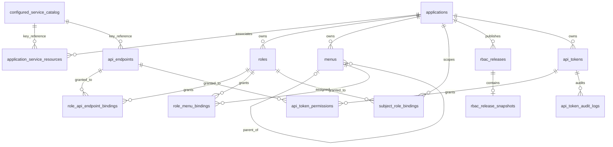

# 当前数据库结构

整理日期：2026-10-10。

[返回当前功能总览](current-system-overview.md) · [初始化 SQL](../migrations/001_init.sql) · [API Token 迁移](../migrations/003_api_tokens.sql)

本文档按 `migrations/001_init.sql` 及增量迁移 `migrations/002_application_url.sql`、`migrations/003_api_tokens.sql` 逐项整理，本次没有对运行中的数据库进行结构比对。`001_init.sql` 是空数据库的纯初始化脚本；`002` 添加应用地址，`003` 以事务和可重复创建语句添加 API Token 表结构，不插入种子数据。

文档中的“允许 NULL”以列声明为准；“默认值”是脚本中的 PostgreSQL 表达式或字面量。`updated_at` 只有插入时的 `DEFAULT NOW()`，脚本没有自动更新时间触发器。

## 枚举类型

| 枚举 | 值 | 用途 |
| --- | --- | --- |
| `rbac_release_status` | `published`、`superseded` | RBAC 发布版本状态 |
| `service_resource_source` | `local`、`nexusauth` | 服务资源来源 |
| `endpoint_source` | `manual`、`swagger` | API 端点登记来源 |
| `menu_type` | `directory`、`menu`、`button` | 菜单节点类型 |

## 表结构

### `service_resources`

服务资源目录。当前表只允许持久化 `local` 资源；`service_resource_source` 保留 `nexusauth` 枚举值用于兼容，但表级 CHECK 要求 `source = 'local' AND external_id IS NULL`。NexusAuth 资源只由配置的远程目录提供，数据库不持久化远程元数据。API 端点和应用关联通过 `resource_key` 做逻辑关联，不建立指向本表的外键。

| 字段 | 实际 PostgreSQL 类型（长度） | 允许 NULL | 默认值 | 含义 |
| --- | --- | --- | --- | --- |
| `id` | `UUID` | 否 | `gen_random_uuid()` | 服务资源主键 |
| `resource_key` | `VARCHAR(128)` | 否 | 无 | 稳定的服务资源标识 |
| `display_name` | `VARCHAR(200)` | 否 | 无 | 展示名称 |
| `audience` | `VARCHAR(200)` | 否 | `''` | 服务受众标识 |
| `description` | `TEXT` | 否 | `''` | 描述 |
| `source` | `service_resource_source` | 否 | `'local'` | 资源来源 |
| `external_id` | `VARCHAR(200)` | 是 | 无 | 外部系统标识 |
| `enabled` | `BOOLEAN` | 否 | `TRUE` | 是否启用 |
| `created_at` | `TIMESTAMPTZ` | 否 | `NOW()` | 创建时间 |
| `updated_at` | `TIMESTAMPTZ` | 否 | `NOW()` | 更新时间字段；初始化脚本不自动维护 |

约束：主键为 `id`；`resource_key` 唯一；`resource_key` 和 `display_name` 必须满足 `btrim(...) <> ''`；`source = 'local'` 且 `external_id` 必须为 `NULL`。`service_resource_enabled_guard` 按 `resource_key` 禁止停用仍被应用关联的资源，也禁止删除仍有应用关联或 API 端点的本地资源；NexusAuth 资源不写入本表。

### `applications`

权限中心的应用边界。

| 字段 | 实际 PostgreSQL 类型（长度） | 允许 NULL | 默认值 | 含义 |
| --- | --- | --- | --- | --- |
| `id` | `UUID` | 否 | `gen_random_uuid()` | 应用主键 |
| `app_key` | `VARCHAR(128)` | 否 | 无 | 应用稳定标识 |
| `display_name` | `VARCHAR(200)` | 否 | 无 | 应用展示名称 |
| `description` | `TEXT` | 否 | `''` | 应用描述 |
| `enabled` | `BOOLEAN` | 否 | `TRUE` | 是否启用 |
| `created_at` | `TIMESTAMPTZ` | 否 | `NOW()` | 创建时间 |
| `updated_at` | `TIMESTAMPTZ` | 否 | `NOW()` | 更新时间字段；初始化脚本不自动维护 |

约束：主键为 `id`；`app_key` 唯一；`app_key` 和 `display_name` 必须满足 `btrim(...) <> ''`。

### `application_service_resources`

应用与服务资源的多对多关联表。只保存服务资源 key，不保存远程服务的 UUID 或元数据。

| 字段 | 实际 PostgreSQL 类型（长度） | 允许 NULL | 默认值 | 含义 |
| --- | --- | --- | --- | --- |
| `application_id` | `UUID` | 否 | 无 | 应用外键 |
| `service_resource_key` | `VARCHAR(128)` | 否 | 无 | 服务资源业务键；由配置的服务资源目录校验，不是数据库外键 |
| `created_at` | `TIMESTAMPTZ` | 否 | `NOW()` | 关联创建时间 |

约束：复合主键为 (`application_id`, `service_resource_key`)；`application_id` 外键引用 `applications(id)`，`ON DELETE CASCADE`。应用服务仓储通过当前目录校验新关联必须存在且启用；已存在但暂时不可用的关联会以停用的 key-only 占位记录返回，以便解除关联。

### `api_endpoints`

归属于服务资源的可授权 HTTP API 端点。

| 字段 | 实际 PostgreSQL 类型（长度） | 允许 NULL | 默认值 | 含义 |
| --- | --- | --- | --- | --- |
| `id` | `UUID` | 否 | `gen_random_uuid()` | API 端点主键 |
| `service_resource_key` | `VARCHAR(128)` | 否 | 无 | 所属服务资源业务键；由服务资源目录校验，不是数据库外键 |
| `endpoint_key` | `VARCHAR(160)` | 否 | 无 | 服务内端点稳定标识 |
| `method` | `VARCHAR(16)` | 否 | 无 | HTTP 方法，必须大写 |
| `path_template` | `VARCHAR(500)` | 否 | 无 | 路径模板，必须以 `/` 开头 |
| `module` | `VARCHAR(200)` | 否 | `''` | 模块或控制器 |
| `summary` | `TEXT` | 否 | `''` | API 摘要 |
| `source` | `endpoint_source` | 否 | `'manual'` | 登记来源 |
| `enabled` | `BOOLEAN` | 否 | `TRUE` | 是否启用 |
| `last_discovered_at` | `TIMESTAMPTZ` | 是 | 无 | 最近发现时间 |
| `created_at` | `TIMESTAMPTZ` | 否 | `NOW()` | 创建时间 |
| `updated_at` | `TIMESTAMPTZ` | 否 | `NOW()` | 更新时间字段；初始化脚本不自动维护 |

约束：主键为 `id`；(`service_resource_key`, `endpoint_key`) 唯一；(`service_resource_key`, `method`, `path_template`) 唯一；`endpoint_key` 非空白；`method = upper(method)`；`left(path_template, 1) = '/'`。创建、查询和更新 API 前由当前服务资源目录校验 key 存在且启用；数据库不建立服务资源外键。

### `api_tokens`

按应用保存 API Token 元数据。数据库只保存 SHA-256 十六进制 hash，不保存明文凭证；完整 `raw_token` 只在创建或轮换成功响应中返回一次。

| 字段 | 实际 PostgreSQL 类型（长度） | 允许 NULL | 默认值 | 含义 |
| --- | --- | --- | --- | --- |
| `id` | `UUID` | 否 | 无 | Token 主键，由应用生成 |
| `application_id` | `UUID` | 否 | 无 | 应用外键 |
| `name` | `VARCHAR(200)` | 否 | 无 | Token 名称 |
| `token_prefix` | `VARCHAR(32)` | 否 | 无 | 展示用前缀 |
| `token_hash` | `VARCHAR(64)` | 否 | 无 | SHA-256 十六进制 hash，不是明文凭证 |
| `owner_type` | `VARCHAR(16)` | 否 | 无 | `user` 或 `service` |
| `owner_id` | `VARCHAR(200)` | 否 | 无 | 主体标识 |
| `status` | `VARCHAR(16)` | 否 | `'active'` | `active`、`disabled` 或 `revoked` |
| `expires_at` | `TIMESTAMPTZ` | 是 | 无 | 过期时间；NULL 表示不过期 |
| `last_used_at` | `TIMESTAMPTZ` | 是 | 无 | 最近一次成功使用时间 |
| `created_by` | `VARCHAR(200)` | 否 | `'system'` | 创建操作者 |
| `created_at` | `TIMESTAMPTZ` | 否 | `NOW()` | 创建时间 |
| `updated_at` | `TIMESTAMPTZ` | 否 | `NOW()` | 更新时间字段 |
| `revoked_at` | `TIMESTAMPTZ` | 是 | 无 | 撤销时间 |

约束：主键为 `id`；`application_id` 外键引用 `applications(id)`，`ON DELETE CASCADE`；`token_hash` 唯一且必须为 64 位小写十六进制；主体类型、状态和非空字段受 CHECK 约束；`status = 'revoked'` 必须与 `revoked_at IS NOT NULL` 同步。`api_tokens_application_idx` 按应用和创建时间查询，`api_tokens_prefix_idx` 支持前缀搜索，`api_tokens_token_hash_uq` 防止 hash 重复。

### `api_token_permissions`

Token 对应用已关联服务 API 端点的授权集合。每条记录保存授予时的端点方法、路径模板和摘要快照，目录后续变化不会隐式扩大已有 Token 的授权边界。

| 字段 | 实际 PostgreSQL 类型（长度） | 允许 NULL | 默认值 | 含义 |
| --- | --- | --- | --- | --- |
| `token_id` | `UUID` | 否 | 无 | Token 外键 |
| `endpoint_id` | `UUID` | 否 | 无 | API 端点外键 |
| `service_resource_key` | `VARCHAR(128)` | 否 | 无 | 授予时的服务资源 key |
| `action` | `VARCHAR(16)` | 否 | 无 | `read` 或 `write` |
| `tenant_id` | `VARCHAR(200)` | 否 | `''` | 租户范围，空值表示不限 |
| `project_id` | `VARCHAR(200)` | 否 | `''` | 项目范围，空值表示不限 |
| `method` | `VARCHAR(16)` | 否 | 无 | 授予时的 HTTP 方法快照 |
| `path_template` | `VARCHAR(500)` | 否 | 无 | 授予时的路径模板快照 |
| `summary` | `TEXT` | 否 | `''` | 授予时的摘要快照 |

约束：复合主键为 (`token_id`, `endpoint_id`, `tenant_id`, `project_id`)；`token_id` 外键引用 `api_tokens(id)`，`ON DELETE CASCADE`；`endpoint_id` 外键引用 `api_endpoints(id)`，`ON DELETE RESTRICT`；方法必须大写、路径必须以 `/` 开头，action 只允许 `read`/`write`。`api_token_permission_scope_guard` 还要求端点所属服务与记录一致，且该服务已关联 Token 所属应用；应用层在事务中另外重新校验端点仍存在、启用且快照未变化。`api_token_permissions_endpoint_idx` 支持按端点反查。

### `api_token_audit_logs`

API Token 成功创建、编辑、启停、撤销和轮换等写操作的审计记录；当前没有查询审计日志的 UI 或公开查询接口。

| 字段 | 实际 PostgreSQL 类型（长度） | 允许 NULL | 默认值 | 含义 |
| --- | --- | --- | --- | --- |
| `id` | `UUID` | 否 | `gen_random_uuid()` | 审计记录主键 |
| `token_id` | `UUID` | 否 | 无 | Token 外键 |
| `actor_id` | `VARCHAR(200)` | 否 | `'system'` | 操作者标识 |
| `action` | `VARCHAR(64)` | 否 | 无 | 成功操作类型 |
| `created_at` | `TIMESTAMPTZ` | 否 | `NOW()` | 记录时间 |

约束：`token_id` 外键引用 `api_tokens(id)`，`ON DELETE CASCADE`；操作者和 action 不能为空白。`api_token_audit_logs_token_idx` 按 Token 和时间倒序查询。

### `roles`

应用范围内的角色。

| 字段 | 实际 PostgreSQL 类型（长度） | 允许 NULL | 默认值 | 含义 |
| --- | --- | --- | --- | --- |
| `id` | `UUID` | 否 | `gen_random_uuid()` | 角色主键 |
| `application_id` | `UUID` | 否 | 无 | 所属应用 |
| `code` | `VARCHAR(160)` | 否 | 无 | 角色编码 |
| `name` | `VARCHAR(200)` | 否 | 无 | 角色名称 |
| `description` | `TEXT` | 否 | `''` | 角色描述 |
| `enabled` | `BOOLEAN` | 否 | `TRUE` | 是否启用 |
| `created_at` | `TIMESTAMPTZ` | 否 | `NOW()` | 创建时间 |
| `updated_at` | `TIMESTAMPTZ` | 否 | `NOW()` | 更新时间字段；初始化脚本不自动维护 |

约束：主键为 `id`；外键 `application_id` 引用 `applications(id)`，`ON DELETE CASCADE`；(`application_id`, `code`) 唯一；(`id`, `application_id`) 复合唯一键供跨表归属校验；`code` 和 `name` 必须非空白。

### `menus`

应用范围内的目录、菜单和按钮节点。

| 字段 | 实际 PostgreSQL 类型（长度） | 允许 NULL | 默认值 | 含义 |
| --- | --- | --- | --- | --- |
| `id` | `UUID` | 否 | `gen_random_uuid()` | 菜单节点主键 |
| `application_id` | `UUID` | 否 | 无 | 所属应用 |
| `parent_id` | `UUID` | 是 | 无 | 父节点；根节点为 NULL |
| `menu_type` | `menu_type` | 否 | 无 | `directory`、`menu` 或 `button` |
| `code` | `VARCHAR(160)` | 否 | 无 | 节点编码 |
| `name` | `VARCHAR(200)` | 否 | 无 | 节点名称 |
| `route` | `VARCHAR(500)` | 否 | `''` | 路由 |
| `component` | `VARCHAR(300)` | 否 | `''` | 前端组件 |
| `icon` | `VARCHAR(100)` | 否 | `''` | 图标标识 |
| `sort_order` | `INTEGER` | 否 | `0` | 排序值 |
| `enabled` | `BOOLEAN` | 否 | `TRUE` | 是否启用 |
| `created_at` | `TIMESTAMPTZ` | 否 | `NOW()` | 创建时间 |
| `updated_at` | `TIMESTAMPTZ` | 否 | `NOW()` | 更新时间字段；初始化脚本不自动维护 |

约束：主键为 `id`；外键 `application_id` 引用 `applications(id)`，`ON DELETE CASCADE`；(`application_id`, `code`) 唯一；(`id`, `application_id`) 复合唯一键；(`parent_id`, `application_id`) 外键引用 `menus(id, application_id)`，`ON DELETE RESTRICT`；`code` 和 `name` 必须非空白。

数据库只通过复合自引用外键保障父节点属于同一应用，并没有循环检测触发器，也没有 `menu_type` 与父节点类型的 `CHECK`。当前后端仓储已校验菜单循环，前端校验按钮必须归属菜单、按钮不得有子项等规则；这些不是本初始化脚本中的数据库触发器保障。

### `role_api_endpoint_bindings`

角色与 API 端点的多对多授权关联。

| 字段 | 实际 PostgreSQL 类型（长度） | 允许 NULL | 默认值 | 含义 |
| --- | --- | --- | --- | --- |
| `role_id` | `UUID` | 否 | 无 | 角色外键 |
| `endpoint_id` | `UUID` | 否 | 无 | API 端点外键 |
| `created_at` | `TIMESTAMPTZ` | 否 | `NOW()` | 授权关联创建时间 |

约束：复合主键为 (`role_id`, `endpoint_id`)；`role_id` 外键引用 `roles(id)`，`ON DELETE CASCADE`；`endpoint_id` 外键引用 `api_endpoints(id)`，`ON DELETE CASCADE`。`role_api_endpoint_application_guard` 还要求端点所属服务已关联到角色所属应用。

### `role_menu_bindings`

角色与菜单/按钮节点的多对多授权关联。

| 字段 | 实际 PostgreSQL 类型（长度） | 允许 NULL | 默认值 | 含义 |
| --- | --- | --- | --- | --- |
| `role_id` | `UUID` | 否 | 无 | 角色外键 |
| `menu_id` | `UUID` | 否 | 无 | 菜单节点外键 |
| `created_at` | `TIMESTAMPTZ` | 否 | `NOW()` | 授权关联创建时间 |

约束：复合主键为 (`role_id`, `menu_id`)；`role_id` 外键引用 `roles(id)`，`ON DELETE CASCADE`；`menu_id` 外键引用 `menus(id)`，`ON DELETE CASCADE`。`role_menu_application_guard` 要求角色和菜单属于同一应用。

### `subject_role_bindings`

应用内主体、域与角色的绑定。

| 字段 | 实际 PostgreSQL 类型（长度） | 允许 NULL | 默认值 | 含义 |
| --- | --- | --- | --- | --- |
| `id` | `UUID` | 否 | `gen_random_uuid()` | 绑定主键 |
| `application_id` | `UUID` | 否 | 无 | 所属应用 |
| `subject` | `VARCHAR(200)` | 否 | 无 | 身份主体 |
| `domain` | `VARCHAR(200)` | 否 | `'global'` | 身份域 |
| `role_id` | `UUID` | 否 | 无 | 角色外键 |
| `created_at` | `TIMESTAMPTZ` | 否 | `NOW()` | 创建时间 |
| `updated_at` | `TIMESTAMPTZ` | 否 | `NOW()` | 更新时间字段；初始化脚本不自动维护 |

约束：主键为 `id`；`application_id` 外键引用 `applications(id)`，`ON DELETE CASCADE`；(`application_id`, `subject`, `domain`, `role_id`) 唯一；(`role_id`, `application_id`) 外键引用 `roles(id, application_id)`，`ON DELETE CASCADE`；`subject` 和 `domain` 必须非空白。

### `rbac_releases`

应用权限快照的发布版本元数据。

| 字段 | 实际 PostgreSQL 类型（长度） | 允许 NULL | 默认值 | 含义 |
| --- | --- | --- | --- | --- |
| `id` | `UUID` | 否 | `gen_random_uuid()` | 发布版本主键 |
| `application_id` | `UUID` | 否 | 无 | 所属应用 |
| `version` | `BIGINT` | 否 | 无 | 应用内版本号 |
| `status` | `rbac_release_status` | 否 | `'published'` | 发布状态 |
| `description` | `TEXT` | 否 | `''` | 版本说明 |
| `checksum` | `VARCHAR(64)` | 否 | 无 | 快照校验和 |
| `published_by` | `VARCHAR(200)` | 否 | 无 | 发布者 |
| `published_at` | `TIMESTAMPTZ` | 否 | `NOW()` | 发布时间 |

约束：主键为 `id`；`application_id` 外键引用 `applications(id)`，`ON DELETE CASCADE`；(`application_id`, `version`) 唯一。脚本没有“每个应用只能有一个 `published` 版本”的唯一约束；`rbac_releases_application_active_idx` 是带 `WHERE status = 'published'` 的普通索引，不是唯一部分索引。

### `rbac_release_snapshots`

发布版本对应的 JSONB 快照；正常发布流程创建后只读，DDL 本身没有禁止直接更新快照的触发器。

| 字段 | 实际 PostgreSQL 类型（长度） | 允许 NULL | 默认值 | 含义 |
| --- | --- | --- | --- | --- |
| `release_id` | `UUID` | 否 | 无 | 发布版本主键，同时是快照主键 |
| `snapshot` | `JSONB` | 否 | 无 | 权限快照对象 |

约束：`release_id` 为主键，并外键引用 `rbac_releases(id)`，`ON DELETE CASCADE`；`snapshot` 必须满足 `jsonb_typeof(snapshot) = 'object'`。

## 数据库触发器

`001_init.sql` 定义 4 个触发器，`003_api_tokens.sql` 再增加 1 个 Token 权限范围触发器，均为数据库层保障：

| 触发器 | 时机 | 作用 |
| --- | --- | --- |
| `service_resource_enabled_guard` | `service_resources.enabled` 更新或删除前、逐行 | 按 `resource_key` 禁止停用仍有关联的本地资源；禁止删除仍有应用关联或 API 端点的本地资源。 |
| `application_service_resource_grant_guard` | `application_service_resources` 删除前、逐行 | 如果该应用已有角色授予该服务资源下 API，则禁止解除关联。 |
| `role_api_endpoint_application_guard` | `role_api_endpoint_bindings` 插入或更新前、逐行 | 按端点的 `service_resource_key` 检查角色所属应用已关联该服务资源。 |
| `role_menu_application_guard` | `role_menu_bindings` 插入或更新前、逐行 | 检查角色和菜单属于同一应用。 |
| `api_token_permission_scope_guard` | `api_token_permissions` 插入或更新前、逐行 | 检查 Token 端点服务与记录一致，且该服务已关联 Token 所属应用。 |

上述触发器没有负责菜单树循环检测，也没有负责按钮父级类型或按钮归属校验。`menus` 的复合自引用外键只保证父节点 ID 与应用 ID 配对；前端或应用服务层的循环/按钮规则属于应用层校验，不能归因于这 5 个数据库触发器。

## 显式索引

PostgreSQL 会为主键和 `UNIQUE` 约束自动创建索引，但不会自动为引用侧外键列建索引。除此之外，脚本显式创建以下 11 个索引（其中 Token hash 索引为唯一索引）：

| 索引 | 表 | 索引列 / 条件 | 用途 |
| --- | --- | --- | --- |
| `api_endpoints_scope_enabled_idx` | `api_endpoints` | (`service_resource_key`, `enabled`) | 按服务资源和启用状态查询端点 |
| `role_api_endpoint_bindings_endpoint_idx` | `role_api_endpoint_bindings` | (`endpoint_id`, `role_id`) | 按端点反查角色 |
| `subject_role_bindings_application_lookup_idx` | `subject_role_bindings` | (`application_id`, `subject`, `domain`) | 按应用、主体和域查询角色绑定 |
| `menus_application_enabled_idx` | `menus` | (`application_id`, `enabled`, `sort_order`) | 按应用查询启用菜单并排序 |
| `rbac_releases_application_active_idx` | `rbac_releases` | (`application_id`, `version DESC`) `WHERE status = 'published'` | 查询应用的已发布版本并按版本倒序；是普通部分索引，不是唯一索引 |
| `application_service_resources_service_idx` | `application_service_resources` | (`service_resource_key`, `application_id`) | 按服务资源反查应用 |
| `api_tokens_token_hash_uq` | `api_tokens` | (`token_hash`) 唯一 | 防止 Token hash 重复 |
| `api_tokens_application_idx` | `api_tokens` | (`application_id`, `created_at DESC`) | 按应用分页查询 Token |
| `api_tokens_prefix_idx` | `api_tokens` | (`token_prefix`) | 按展示前缀搜索 Token |
| `api_token_permissions_endpoint_idx` | `api_token_permissions` | (`endpoint_id`) | 按端点反查 Token 权限 |
| `api_token_audit_logs_token_idx` | `api_token_audit_logs` | (`token_id`, `created_at DESC`) | 按 Token 查询审计记录 |

## 关系概览

图中的 `configured_service_catalog` 是配置选择的资源来源（local 本地表或 NexusAuth 远程接口），不是新增数据库表。它与应用关联和 API 端点之间是业务上的 key 关联；`application_service_resources` 与 `api_endpoints` 均不对 `service_resources` 建立数据库外键。

## 明确不包含的结构

- 初始化脚本不创建用户表；主体以 `subject` 字符串保存在 `subject_role_bindings`，身份来源不由此 schema 管理。
- 初始化脚本不创建 OAuth 客户端表。
- 初始化脚本不创建独立的 API 字段权限表；API 端点在 `api_endpoints`，角色授权通过 `role_api_endpoint_bindings` 表示，Token 授权通过 `api_token_permissions` 表示。
- 初始化脚本不插入任何应用、服务资源、角色、菜单、绑定或发布版本种子数据。

## 增量迁移

`003_api_tokens.sql` 使用 `BEGIN`/`COMMIT`，表、索引和触发器创建语句可重复执行；它依赖 `001_init.sql` 创建的 `applications`、`application_service_resources`、`api_endpoints` 和 `pgcrypto`。API Token repository 在创建、更新、状态变更和轮换时使用本地事务；数据库结构本身不保存明文 Token，也没有缓存授权目录。
