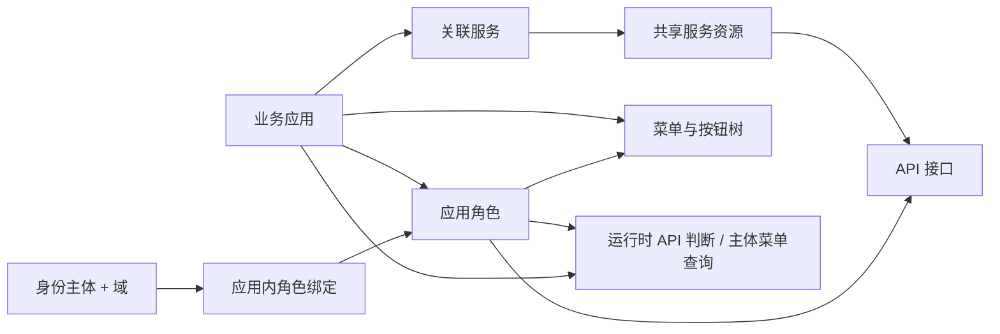

# 权限中心当前功能与数据模型

整理日期：2026-10-14。示例应用、接口和用户标识均用于说明，不代表数据库中的真实数据。

本文以当前工作区代码和 `migrations/001_init.sql` 为依据，描述本次应用化重构与 UI 调整后的实现，不把设计想法当作已完成能力。表结构来自初始化脚本，本次没有连接运行中的数据库核对 schema 或统计真实业务数据。

- [完整字段、约束、索引和触发器说明](current-database-schema.md)
- [完整 PostgreSQL 初始化 SQL](../migrations/001_init.sql)
- [页面设计与验证截图说明](ui-design.md)
- [Go SDK 接入说明](sdk-application-integration.md)

## 1. 当前系统的核心模型

一个业务应用使用一个统一的名称和标识。该应用拥有菜单、按钮、角色和用户绑定；应用通过关联服务资源使用多个服务的 API。角色、绑定、菜单和 API 保存成功后直接参与运行时鉴权，没有发布版本。

| 对象 | 当前职责 | 示例 |
| --- | --- | --- |
| 业务应用 | 组织一个业务系统的权限配置 | `business.portal`：业务管理平台 |
| 服务资源 | 为服务/BFF 建立共享 API 目录 | `order.service`：订单服务 |
| API 接口 | 某个服务的 HTTP 方法和路径 | `GET /api/orders/{id}` |
| 菜单 | 应用内的页面入口，可组成父子层级 | 订单管理、用户管理 |
| 按钮 | 菜单页面内的操作权限节点 | `orders:create`：创建订单 |
| 角色 | 组合应用的菜单/按钮和已关联服务 API | 订单管理员 |
| 主体与域 | 标识被授权的身份及其授权上下文 | `subject=user-001`，`domain=''`（默认域，可省略） |
| 服务 API 授权 String | Redis 启用时由中心全量合并并发布、鉴权只读；禁用时服务 API 使用数据库 current-policy | key：`PREFIX:<escaped service>:<escaped subject>[:<escaped domain>]`；值为完整策略 JSON，不含应用标识；空域和 `global` 无 domain 后缀 |

应用与服务是多对多：一个应用可关联多个服务，同一服务可被多个应用复用。API 属于服务，角色和菜单属于应用。关联服务不会自动给用户或角色授予 API 权限。

业务应用与 OAuth 客户端是不同概念。这里不管理“客户端应用/服务端应用”两套业务应用目录，也不要求新增业务应用时同步创建 OAuth 客户端；管理端 SSO 使用配置中的 OIDC 客户端接入身份平台。



## 2. 当前页面与导航

业务应用选择页位于工作台之外，用于先确定要管理的应用。

| 一级入口 | 二级页面 | 路由 | 当前功能 |
| --- | --- | --- | --- |
| 应用选择 | 选择业务应用 | `/select-application` | 搜索、创建、编辑、启停、选择并进入应用 |
| 配置总览 | — | `/dashboard` | 配置步骤说明、关联服务/API/角色/菜单数量 |
| 资源管理 | 服务资源 | `/service-resources` | 服务目录、服务维护、应用关联、跳转查看服务 API |
| 资源管理 | API 接口 | `/api-resources` | 搜索筛选、手动维护接口、Swagger 导入、分页 |
| 资源管理 | 菜单与按钮 | `/menus` | 树形层级、菜单/按钮维护、展开收起、搜索 |
| RBAC 授权 | 角色管理 | `/roles` | 角色维护、选择跨服务 API、选择菜单与按钮、在“分配用户”中绑定用户（默认空域） |
| 权限验证 | 权限模拟 | `/simulate` | 选择目标服务与 Path、HTTP 方法与 SCIM 用户，按当前配置检查权限 |

工作台还有两个不在侧栏显示的页面：新增角色 `/roles/new` 与编辑角色 `/roles/:roleId/edit`，两者复用同一工作台页面组件。`/bindings` 现在重定向到 `/roles`，用户授权是角色管理抽屉里的操作，不再是独立路由。侧栏支持任意层级分组、当前页面选中和分组展开；工作台支持页面标签、切换应用、明暗主题和全屏。原 `/select-service-resource` 入口重定向到应用选择页。侧栏菜单当前来自前端内置导航定义（`dashboard/src/api/auth.ts` 的 mock 结构），不是后端菜单接口。各页面的字段与操作说明见 [标准使用手册](user-guide.md)。

### 2.1 登录与业务应用

- 管理端支持配置启用的 OIDC/SSO 登录、回调建立会话、当前用户查询与退出登录。
- 登录后选择业务应用，工作台根据所选应用读取权限配置。
- 新建应用填写名称、唯一标识、可选应用地址、描述及启用状态；创建后应用标识不通过编辑页面修改。
- 应用地址为 HTTP/HTTPS Web 入口，启用且已填写有效地址的应用显示“打开应用”，在新标签页打开；权限配置仍通过应用选择入口进入。地址可编辑或清空，不改变角色及鉴权逻辑。
- 停用应用仍可在选择页编辑和重新启用，但不能选择进入工作台；后端 RBAC 操作也会按启用应用查找。
- 应用选择页没有应用删除入口，后端也没有应用删除路由。

### 2.2 服务资源

- 查看名称、服务标识、Audience、启停状态及当前应用是否已关联。
- 搜索服务名称、标识或 Audience；切换全部服务/已关联服务。
- 在本地可写目录模式下新建和编辑服务资源；服务标识创建后保持不变。
- 在 NexusAuth 目录模式下，`List`/`Get` 直接读取远程资源并规范化返回；不会读取、写入或回退到本地 `service_resources` 元数据。local 模式只读取本地 `service_resources`。
- 直接通过服务表格每行的“关联 / 取消关联”操作管理应用关联。
- “查看 API”从已关联服务跳转到 API 页，并带上该服务筛选条件。
- local 模式支持新增、编辑和确认删除；已关联当前应用的资源需先取消关联，后端还会阻止删除被任意应用或 API 端点引用的资源。NexusAuth 模式隐藏新增、编辑、删除入口，后端也拒绝资源写操作。

服务关联和 API 端点使用服务资源 key；目录校验新建关联、API 或授权时服务必须存在且启用。远程资源消失或停用后，已有应用关联仍以停用的 key-only 占位记录返回，便于移除；不能通过新请求添加不可用 key。local 资源仍由数据库触发器按 key 禁止停用已有应用关联的资源，也禁止删除仍有应用关联或 API 端点的资源；应用角色仍授予该服务 API 时不能解除关联。实际解绑顺序是先移除相关角色 API 授权，再解除应用关联。

### 2.3 API 接口与 Swagger 导入

- 手动新增、编辑、删除 API，字段包括接口标识、摘要、目标服务、HTTP 方法、路径、模块和启用状态。
- 按摘要、路径、模块、标识或服务搜索；按服务和 HTTP 方法筛选；列表每页 25 条。
- 接口编辑不能更换归属服务；后端按接口 ID 和服务归属限定更新。
- 导入时由用户选择当前应用已关联且启用的目标服务，再填写 HTTP(S) Swagger/OpenAPI 地址。
- 后端支持 Swagger 2.0、OpenAPI 3.x，以及 JSON/YAML 文档；提取 HTTP 方法、路径、模块与摘要。
- 同一服务内按 `method + path_template` 跳过已存在接口；成功显示总数、新增数、跳过数。
- 导入来源记录为 `swagger`，手工新增来源为 `manual`；导入不会自动授予角色权限。
- 保存/导入期间显示加载状态并防止重复提交；失败后保留表单并展示错误。
- 删除接口前需要确认。

API 是共享目录。某个应用编辑服务的 API 元数据，会修改这条共享接口定义；各应用仍需分别配置角色授权。Redis 启用时，共享接口的启用、路径或删除变更会触发中心全量重算并替换受影响的用户 String；禁用时该修改由数据库 current-policy 直接读取。导入目前逐条保存，不是整批原子事务；中途失败时，已成功写入的接口可能保留，重试通过已存在路径的跳过逻辑继续处理。

### 2.4 菜单与按钮

- 菜单和按钮直接属于业务应用，不需要服务关联或 OAuth 客户端配置。
- 使用同一张 `menus` 表，通过 `menu_type` 区分 `menu`、`button`；`directory` 保留兼容已有目录节点。
- 菜单树按父节点和排序展示，支持搜索名称/权限标识、展开全部、收起全部。
- 可新增顶级菜单、子菜单，也可直接在某个菜单下“添加按钮”。
- 菜单表单包括名称、权限标识、上级、路由、组件、排序与状态；路由可空，填写时前端要求以 `/` 开头。编辑会保留既有图标字段，当前表单不提供图标输入。
- 按钮字段包括名称、权限标识、所属菜单、排序与状态；按钮表单不填写路由、组件、图标，保存时这些字段置空。
- 前端禁止选择自己或后代作上级，禁止将有子项的节点转为按钮，要求按钮选择菜单父节点。
- 后端同样拒绝把按钮设为父节点、拒绝把仍有子节点的节点改为按钮，并检测循环层级。
- 后端校验父节点属于同一应用；数据库复合外键保证父子同应用。
- 有子项的节点不能直接删除；删除叶子节点须二次确认。
- 前端编辑界面保持权限标识不变。

工作台侧栏是权限中心自身的前端 mock 导航；这里维护的菜单树是业务应用的授权资源，两者并非同一份菜单数据。

### 2.5 角色管理

- 新建、编辑、停用及删除应用内角色，角色编码在同一应用内唯一。
- 编辑角色时可同时选择多个已关联服务的 API。
- 同一角色可选择应用内的菜单和按钮节点，界面显示资源类型。
- 保存 API 和菜单授权集合时，数据库验证 API 对应服务已关联当前应用，菜单与角色属于同一应用。
- 角色启停、授权及删除在保存事务提交后立即生效。

API 授权与菜单/按钮授权是两组独立绑定。目前没有“按钮绑定某个 API、勾选按钮自动勾选 API”的联动关系。

### 2.6 用户授权

- 用户授权通过 `/roles` 角色行的“分配用户”抽屉完成，没有独立的用户授权页面。
- 抽屉从 NexusAuth SCIM 目录分页读取用户；可按姓名、用户名和邮箱搜索，目录不落库。
- 当前操作写入默认空域（`domain` 为空串），选择框回显该角色已绑定用户；不能为停用角色或停用用户新增分配，但可取消原绑定。
- 保存时一次调用 `PUT /api/v1/rbac-v1/roles/{id}/subjects`，在一个事务内为当前角色增删成员，只改动该角色，保留这些用户的其它角色和其它 Domain 的绑定；并发为同一用户分配不同角色不会互相覆盖，整批只触发一次 Redis 发布。
- 后端另有 `PUT /api/v1/rbac-v1/subject-roles`，按应用、`subject + domain` 原子替换整组角色；调用者必须自行提交希望保留的完整角色集合，角色须属于同一应用。
- 用户目录失败时禁用保存并提供重试；保存失败时不会部分写入，抽屉停留并允许重试。

当前没有用户资料表、用户同步存储、组织架构、用户组或账号 CRUD。身份账号由统一认证服务提供。后端保留 `domain` 作为授权上下文字符串，默认空串表示默认域，省略、空白和旧值 `global` 都归一为空默认域，其它具名域保持独立；没有独立的域目录或租户管理表，具名域可通过管理 API 配置。

### 2.7 权限模拟与保存生效

- 权限模拟与运行时鉴权使用同一配置模式：Redis 启用时按 `service + subject + domain` 直接读取完整 String 策略，显式禁用时使用数据库 current-policy；策略合并所有启用应用已保存的服务关联、接口、角色和主体绑定，不读取草稿或历史版本。
- 管理保存只提交数据库当前表；Redis 启用时随后在 PostgreSQL advisory lock 下使用同一个 repeatable-read 快照全量合并并替换 String，禁用时不创建 Redis 客户端也不发布。没有发布按钮、版本说明、版本历史、JSONB 快照表、Redis 索引或计数器。
- 数据库不保存任何缓存标记；`applications` 没有 `policy_token`，也没有角色/服务 revision 表，只保留四条业务保护触发器。
- Redis 启用时，每次服务 API 鉴权都直接读取业务 String，严格校验身份、类型、大小和 JSON；不读取数据库、`state`、Lua 或 `rbac:api:app` 辅助 key。String 缺失、内容无效或 Redis 不可用时拒绝。显式禁用时改用数据库 current-policy。详细规则见 [权限生效设计](permission-lifecycle.md)。
- 菜单 current-policy 路径始终读取当前业务表并在进程内编译，不受 Redis 开关控制；配置目录为远程模式时，服务目录读取发生在请求路径，目录读取失败会返回错误并拒绝放行。

应用停用会移除该应用对服务 API 合并策略的贡献；其他启用应用仍提供的权限保留。撤销角色、删除接口或解除服务关联在保存并成功发布后生效；部分发布失败可能保留旧权限到下一轮全量对账。

## 3. BFF / 服务运行时鉴权

当前服务鉴权输入为：

```text
appKey + serviceResource + subject + [domain] + method + path
```

- `appKey` 是调用上下文；Redis 业务策略不保存应用标识，也不按应用隔离同一用户在该服务上的权限。
- `serviceResource` 确定请求所属的服务命名空间，同一路径在不同服务中分别判断。
- `subject` 与 `domain` 定位合并后的用户策略；`domain` 可选，省略或传空白按默认空域处理，具名 domain 相互隔离。
- 所有启用应用对该服务的 API 与角色取并集；某个应用停用、解除关联或撤权不会移除其他来源的权限。
- `method` 与 `path` 匹配完整 Catalog，再检查合并后的 `apis` 是否授予该接口。
- 未匹配接口、接口停用、未授权或路径匹配歧义均拒绝。
- `/orders/{id}` 的参数只匹配一个非空路径段；固定路径优先于参数路径；不提供通配符任意深度匹配。

BFF/业务服务先验证用户身份，再用可信配置的应用标识与服务标识请求权限中心。`POST /api/v1/authorize` 使用服务端 Bearer 凭证，不用管理端浏览器登录会话代替服务凭证；用户身份不能从不可信的角色参数中推断。

请求示例（凭证为占位符）：

```http
POST /api/v1/authorize
Authorization: Bearer <服务端鉴权凭证>
Content-Type: application/json

{
  "appKey": "business.portal",
  "serviceResource": "order.service",
  "subject": "user-001",
  "domain": "",
  "method": "GET",
  "path": "/api/orders/1001"
}
```

成功允许示例：

```json
{
  "allowed": true,
  "effect": "allow",
  "reason": "allowed",
  "matched_roles": ["order.viewer"]
}
```

判断原因包括 `allowed`、`service_resource_required`、`endpoint_not_found`、`endpoint_disabled`、`endpoint_not_granted`、`ambiguous_endpoint`。Redis 启用时，每次服务 API 鉴权直接读取业务 String，严格校验后编译该用户的完整 Catalog 与 API 并集；String 缺失、类型或 JSON 错误、身份不匹配或 Redis 不可用时拒绝，不回源数据库。显式禁用时，服务 API 使用数据库 current-policy 鉴权。匹配采用哈希、路径 Trie 和稀疏角色位图，详见 [鉴权匹配与性能](authorization-matching.md) 与 [Redis 接入说明](redis-integration.md)。响应不包含发布版本号；请求缺少必要字段或凭证不符时，HTTP 层可能返回错误，不能一概当作正常的 deny 响应。

Go SDK 已提供 `Check` 以及 HTTP 中间件 `Require(appKey, serviceResource, resolve, next)`。身份解析由接入服务负责；身份无效返回 401，鉴权错误或拒绝返回 403；SDK 请求默认有 3 秒超时。

主体菜单查询接口从同一份当前记录返回被授予的菜单/按钮，并补齐启用的祖先节点。父节点停用、缺失或存在循环时，对应分支不返回。前端可基于返回的按钮权限控制操作入口，后端 API 仍须独立鉴权。

## 4. 主流程与写入表

| 操作 | 主要写入表 | 下一步 |
| --- | --- | --- |
| 新建业务应用 | `applications` | 进入应用配置 |
| 新建或编辑本地服务 | `service_resources` | 关联服务 |
| 读取 NexusAuth 服务目录 | 远程目录（不落库） | 关联服务 |
| 关联应用与服务 key | `application_service_resources` | 维护/导入 API |
| 手动维护或导入 API | `api_endpoints` | 角色选择接口 |
| 创建菜单与按钮 | `menus` | 角色选择菜单/按钮 |
| 保存角色及授权 | `roles`、`role_api_endpoint_bindings`、`role_menu_bindings` | 为主体分配角色 |
| 保存主体角色集合 | `subject_role_bindings` | 模拟/运行时验证 |

建议操作顺序：创建应用 → 关联服务 → 导入 API 与配置菜单按钮 → 配置角色授权 → 分配用户角色 → 模拟并验证实际服务请求。每次保存提交后权限立即生效；Redis 启用时，只有应用、服务关联、API、角色和主体角色绑定等会影响服务 API 权限的保存才触发 String 全量重算，纯菜单/按钮编辑只走独立 current-policy。Redis 禁用时，保存直接进入数据库 current-policy。

## 5. 表结构总览

共 **9 张应用 RBAC 及服务目录表、3 个枚举、4 个业务保护触发器、7 个显式索引**。完整字段见 [数据库结构文档](current-database-schema.md)。服务资源关联和 API 端点通过 `service_resource_key VARCHAR(128)` 与当前目录逻辑关联，不建立指向 `service_resources` 的数据库外键。触发器只有 4 个业务保护触发器，没有应用标记刷新或语句级缓存失效触发器。

| 表 | 含义 | 主键 / 关键关系 |
| --- | --- | --- |
| `applications` | 业务应用 | UUID `id`；`app_key` 全局唯一 |
| `service_resources` | 共享服务目录 | UUID `id`；`resource_key` 全局唯一 |
| `application_service_resources` | 应用与服务 key 多对多 | 复合主键 `(application_id, service_resource_key)`；服务 key 由目录校验 |
| `api_endpoints` | 服务的 API 定义 | UUID `id`；`service_resource_key` 由目录校验；服务内接口标识和方法路径各唯一 |
| `roles` | 应用角色 | UUID `id`；应用内 `code` 唯一 |
| `menus` | 应用菜单/按钮/目录树 | UUID `id`；应用内 `code` 唯一；父子同应用 |
| `role_api_endpoint_bindings` | 角色授权 API | 复合主键 `(role_id, endpoint_id)` |
| `role_menu_bindings` | 角色授权菜单/按钮 | 复合主键 `(role_id, menu_id)` |
| `subject_role_bindings` | 应用内主体域角色绑定 | UUID `id`；应用/主体/域/角色组合唯一 |

这 9 张表由 `001_init.sql` 创建；脚本无业务种子数据，可选应用地址 `applications.url` 已包含在初始 schema 中。第一次安装使用空库执行 `001_init.sql`；其中 `subject_role_bindings.domain` 为 `NOT NULL DEFAULT ''`。字段 `updated_at` 的更新由写入代码负责，DDL 未设置自动更新时间触发器。

### 删除与停用语义

| 对象 | 删除 | 停用 |
| --- | --- | --- |
| 业务应用 | 无删除路由 | `enabled=false`，需要重新启用；停用立即生效 |
| 服务资源 | 物理 `DELETE`（仓储方法名为 `SoftDelete`），触发器阻止删除仍被应用关联或 API 端点引用的资源 | `enabled=false`，触发器阻止停用仍被应用关联的本地资源 |
| API Endpoint | 物理删除；Redis 启用时控制面在提交后重建关联应用的 Service API 记录，禁用时数据库路径直接读取 | `enabled=false`，保存提交后立即生效 |
| 角色 | 物理删除，级联删除其 API/菜单授权与主体绑定 | `enabled=false`，保存提交后立即生效 |
| 菜单/按钮 | 物理删除，子节点存在时被复合外键阻止 | `enabled=false`，保存提交后立即生效 |
| 主体角色绑定 | `PUT` 替换时按 `subject + domain` 删除旧集合 | 无独立停用字段 |

RBAC v1 这些表没有 `is_deleted` 软删标记；当前没有发布版本、历史回滚或快照表，也没有 `GET /api/v1/rbac-v1/releases` 路由。

## 6. 当前主要接口

以下为后端 canonical 路径；前端通过 `/api` 代理访问时保留前缀，浏览器请求 `/api/v1/applications` 到达后端仍是 `/api/v1/applications`。

| 能力 | 方法与路径 | 范围参数 |
| --- | --- | --- |
| 登录配置、登录、当前身份、退出 | `GET /api/auth/config`、`GET /api/auth/login`、`GET /api/auth/me`、`POST /api/auth/logout` | OIDC/本地会话配置 |
| OIDC 回调 | `GET /signin-oidc` | 认证协议参数（位于 `/api` 前缀之外） |
| 应用列表/创建/编辑 | `GET/POST /api/v1/applications`、`PUT /api/v1/applications/{key}` | 应用 key |
| 服务目录/创建/查询/编辑/删除 | `GET/POST /api/v1/service-resources`、`GET/PUT/DELETE /api/v1/service-resources/{key}` | 服务 key；写操作受目录来源限制 |
| 应用服务关联 | `GET/PUT /api/v1/applications/{key}/service-resources` | 应用 key；PUT 替换整个集合 |
| API 列表/保存/删除 | `GET/POST /api/v1/rbac-v1/endpoints`、`DELETE /api/v1/rbac-v1/endpoints/{id}` | `app_key`；写操作指定 `service_resource` |
| Swagger 导入 | `POST /api/v1/rbac-v1/endpoints/import-swagger` | `app_key`、`service_resource`；正文 `swagger_url` |
| 角色列表/保存/删除 | `GET/POST /api/v1/rbac-v1/roles`、`DELETE /api/v1/rbac-v1/roles/{id}` | `app_key` |
| 菜单列表/保存/删除 | `GET/POST /api/v1/rbac-v1/menus`、`DELETE /api/v1/rbac-v1/menus/{id}` | `app_key` |
| 主体角色列表/替换 | `GET/PUT /api/v1/rbac-v1/subject-roles` | `app_key`；正文 `subject`、`role_ids`，`domain` 可选 |
| 权限模拟 | `POST /api/v1/rbac-v1/simulate` | `app_key`；正文服务、主体、方法、路径，`domain` 可选 |
| 主体菜单与按钮查询 | `GET /api/v1/rbac-v1/subject-menus` | `app_key`、`subject`，`domain` 可选 |
| BFF/服务鉴权 | `POST /api/v1/authorize` | 服务 Bearer 凭证及鉴权正文 |

启用 OIDC 时，管理路由先认证，再按管理服务标识、用户、方法和路径查询 Redis 中的服务 API 策略；权限不足返回 403，存储异常返回 503。管理权限按服务合并，不按应用隔离。初始化步骤见 [运维手册](operations-manual.md#管理-api-权限初始化)。OIDC 关闭时管理路由不执行认证和权限检查。


## 7. 已实现边界与待补能力

| 能力 | 当前状态 |
| --- | --- |
| 统一业务应用、跨服务 API 授权 | 已实现 |
| 应用内菜单与按钮、父子树结构 | 已实现 |
| 主体/域的多角色绑定 | 已实现 |
| 保存即生效与服务 API 鉴权 | 已实现 |
| 菜单/按钮与 API 自动联动授权 | 未实现；两套独立绑定 |
| API 请求/响应字段可见、脱敏、编辑权限 | 未实现；没有字段资源或字段授权表/引擎 |
| 行级数据权限、ABAC 条件、显式 deny 策略 | 未实现；当前为接口级 RBAC，缺授权即拒绝 |
| 用户资料、用户组、部门、组织架构管理 | 未实现；仅记录身份主体授权关系 |
| 应用自动创建 OAuth 客户端 | 未实现；业务应用和 SSO 客户端配置独立 |
| 发布版本、版本差异、回滚界面 | 未实现，且当前设计不提供 |
| 权限中心管理操作的接口级授权 | OIDC 启用时使用 Redis 服务 API 策略；不按应用隔离 |
| 管理写操作审计 | 结构化日志记录操作者、目标路径、查询范围、HTTP 结果及请求 ID；无配置差异、审计表或查询页面 |

还需区分规则所在层级：按钮必须是叶子、按钮不能作为父节点、不能把有子节点的菜单改为按钮，这些后端已经拒绝，数据库复合外键保证父子同应用，但“按钮必须挂在菜单下”仍主要由前端表单约束，不能说成数据库已完整保障。

共享 API 的普通修改会立即影响所有关联应用。Redis 启用时，接口目录、角色、绑定、应用启停或服务关联变更都会触发全量重算；某个应用停用或撤权只移除它的来源，其他仍在提供权限的应用保持不变。完整替换没有环境级原子性，部分发布失败可能保留旧权限到下一轮对账，保存返回 `PUBLISH_PENDING`。Redis 禁用时，这些修改由数据库 current-policy 在下一次鉴权时读取。共享接口的启用/删除仍需评估所有关联应用的影响范围。

## 8. 代码依据

| 内容 | 依据 |
| --- | --- |
| 完整表结构 | `migrations/001_init.sql` |
| 导航与资源 UI | `dashboard/src/api/auth.ts`（导航 mock）、`dashboard/src/router/workbench-menu.ts`、`dashboard/src/router/workbench-routes.tsx`、`dashboard/src/layouts/layout/side/workbench-menu.tsx`、`dashboard/src/pages/policy-workbench/` |
| 后端路由与管理接口 | `src/internal/server/http/routes.go`、`rbac_v1_handler.go`、`application_handler.go`、`application_permissions_handler.go` |
| 应用与服务关联 | `src/internal/biz/application.go`、`src/internal/data/db/repo/application_repo.go` |
| 服务资源目录与 NexusAuth 读取 | `src/internal/biz/service_resource.go`、`src/internal/data/db/repo/service_resource_repo.go` |
| Swagger、当前权限与 API 鉴权 | `src/internal/biz/swagger.go`、`src/internal/biz/rbac_v1.go`、`src/internal/biz/rbac_policy.go`、`src/internal/biz/rbac_policy_cache.go`、`src/internal/biz/subject_api_authorization.go`、`src/internal/data/db/repo/current_policy_repo.go`、`src/internal/data/db/repo/subject_api_repo.go`、`src/internal/data/rediscache/subject_api.go` |
| 菜单层级与主体菜单 | `src/internal/biz/application_permissions.go`、`src/internal/data/db/repo/application_permissions_repo.go` |
| Go 服务 SDK | `sdk/rbac/client.go` |
