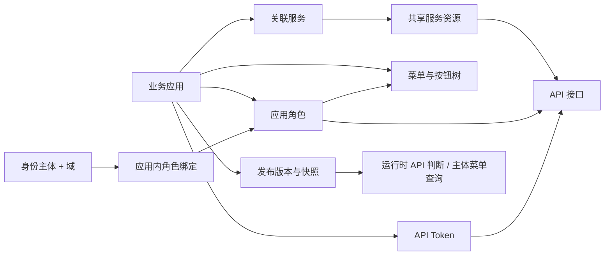

# 权限中心当前功能与数据模型

整理日期：2026-10-10。示例应用、接口和用户标识均用于说明，不代表数据库中的真实数据。

本文以当前工作区代码和 `migrations/001_init.sql`、`migrations/003_api_tokens.sql` 为依据，描述本次应用化重构与 UI 调整后的实现，不把设计想法当作已完成能力。表结构来自迁移脚本，本次没有连接运行中的数据库核对 schema 或统计真实业务数据。

- [完整字段、约束、索引和触发器说明](current-database-schema.md)
- [完整 PostgreSQL 初始化 SQL](../migrations/001_init.sql)
- [API Token 增量迁移](../migrations/003_api_tokens.sql)
- [页面设计与验证截图说明](ui-design.md)
- [Go SDK 接入说明](sdk-application-integration.md)

## 1. 当前系统的核心模型

一个业务应用使用一个统一的名称和标识。该应用拥有菜单、按钮、角色、用户授权及发布版本；应用通过关联服务资源使用多个服务的 API。

| 对象 | 当前职责 | 示例 |
| --- | --- | --- |
| 业务应用 | 组织一个业务系统的权限配置和发布 | `business.portal`：业务管理平台 |
| 服务资源 | 为服务/BFF 建立共享 API 目录 | `order.service`：订单服务 |
| API 接口 | 某个服务的 HTTP 方法和路径 | `GET /api/orders/{id}` |
| 菜单 | 应用内的页面入口，可组成父子层级 | 订单管理、用户管理 |
| 按钮 | 菜单页面内的操作权限节点 | `orders:create`：创建订单 |
| 角色 | 组合应用的菜单/按钮和已关联服务 API | 订单管理员 |
| 主体与域 | 标识被授权的身份及其授权上下文 | `subject=user-001`，`domain=global` |
| API Token | 应用范围的机器主体凭证，可授予多个已关联服务的 API | `service=directory-sync`，`read GET /api/orders/{id}` |
| 发布版本 | 保存该应用某一时刻的权限配置快照 | 应用发布 v1、v2 |

应用与服务是多对多：一个应用可关联多个服务，同一服务可被多个应用复用。API 属于服务，角色和菜单属于应用。关联服务不会自动给用户或角色授予 API 权限。

业务应用与 OAuth 客户端是不同概念。这里不管理“客户端应用/服务端应用”两套业务应用目录，也不要求新增业务应用时同步创建 OAuth 客户端；管理端 SSO 使用配置中的 OIDC 客户端接入身份平台。



## 2. 当前页面与导航

业务应用选择页位于工作台之外，用于先确定要管理的应用。

| 一级入口 | 二级页面 | 路由 | 当前功能 |
| --- | --- | --- | --- |
| 应用选择 | 选择业务应用 | `/select-application` | 搜索、创建、编辑、启停、选择并进入应用 |
| 配置总览 | — | `/dashboard` | 配置步骤说明、关联服务/API/角色/菜单数量 |
| 资源管理 | 服务资源 | `/service-resources` | 服务目录、服务维护、应用关联、跳转查看服务 API |
| 资源管理 | API 接口 | `/api-resources` | 搜索筛选、手动维护接口、Swagger 导入、分页 |
| RBAC 授权 | API Token | `/api-tokens` | 按当前应用创建、编辑、启停、撤销和轮换 Token；选择已关联服务的启用 API |
| 资源管理 | 菜单与按钮 | `/menus` | 树形层级、菜单/按钮维护、展开收起、搜索 |
| RBAC 授权 | 角色管理 | `/roles` | 角色维护、选择跨服务 API、选择菜单与按钮 |
| RBAC 授权 | 用户授权 | `/bindings` | 为指定主体和域分配应用角色 |
| 发布与验证 | 发布版本 | `/releases` | 填写说明、发布当前配置、查看版本历史 |
| 发布与验证 | 权限模拟 | `/simulate` | 输入主体/域/服务/方法/路径，检查已发布权限 |

侧栏支持两级分组、当前页面选中和分组展开；工作台支持页面标签、切换应用、明暗主题和全屏。原 `/select-service-resource` 入口重定向到应用选择页。

### 2.1 登录与业务应用

- 管理端支持配置启用的 OIDC/SSO 登录、回调建立会话、当前用户查询与退出登录。
- 登录后选择业务应用，工作台根据所选应用读取权限配置。
- 新建应用填写名称、唯一标识、可选应用地址、描述及启用状态；创建后应用标识不通过编辑页面修改。
- 应用地址为 HTTP/HTTPS Web 入口，启用且已填写有效地址的应用显示“打开应用”，在新标签页打开；权限配置仍通过应用选择入口进入。地址可编辑或清空，不改变角色、发布及鉴权逻辑。
- 停用应用仍可在选择页编辑和重新启用，但不能选择进入工作台；后端 RBAC 操作也会按启用应用查找。
- 应用选择页没有应用删除入口，后端也没有应用删除路由。

### 2.2 服务资源

- 查看名称、服务标识、Audience、启停状态及当前应用是否已关联。
- 搜索服务名称、标识或 Audience；切换全部服务/已关联服务。
- 在本地可写目录模式下新建和编辑服务资源；服务标识创建后保持不变。
- 在 NexusAuth 目录模式下，`List`/`Get` 直接读取远程资源并规范化返回；不会读取、写入或回退到本地 `service_resources` 元数据。local 模式只读取本地 `service_resources`。
- 直接通过服务表格每行的“关联 / 取消关联”操作管理应用关联。
- “查看 API”从已关联服务跳转到 API 页，并带上该服务筛选条件。
- local 模式支持新增、编辑和确认删除；已关联当前应用的资源需先取消关联，后端还会阻止删除被任意应用或 API 端点引用的资源。NexusAuth 模式隐藏新增、编辑、删除入口，后端也拒绝资源写操作。

服务关联和 API 端点使用服务资源 key；目录校验新建关联、API 或授权时服务必须存在且启用。远程资源消失或停用后，已有应用关联仍以停用的 key-only 占位记录返回，便于移除；不能通过新请求添加不可用 key。local 资源仍由数据库触发器按 key 禁止停用已有应用关联的资源，也禁止删除仍有应用关联或 API 端点的资源；应用角色仍授予该服务 API 时不能解除关联。实际解绑顺序是先移除相关角色 API 授权，再解除应用关联。

### 2.3 API 接口与 Swagger 导入

- 手动新增、编辑、删除 API，字段包括接口标识、摘要、目标服务、HTTP 方法、路径、模块和启用状态。
- 按摘要、路径、模块、标识或服务搜索；按服务和 HTTP 方法筛选；列表每页 25 条。
- 接口编辑不能更换归属服务；后端按接口 ID 和服务归属限定更新。
- 导入时由用户选择当前应用已关联且启用的目标服务，再填写 HTTP(S) Swagger/OpenAPI 地址。
- 后端支持 Swagger 2.0、OpenAPI 3.x，以及 JSON/YAML 文档；提取 HTTP 方法、路径、模块与摘要。
- 同一服务内按 `method + path_template` 跳过已存在接口；成功显示总数、新增数、跳过数。
- 导入来源记录为 `swagger`，手工新增来源为 `manual`；导入不会自动授予角色权限。
- 保存/导入期间显示加载状态并防止重复提交；失败后保留表单并展示错误。
- 删除接口前需要确认。

API 是共享目录。某个应用编辑服务的 API 元数据，会修改这条共享接口定义；各应用仍需分别配置角色授权、分别发布。导入目前逐条保存，不是整批原子事务；中途失败时，已成功写入的接口可能保留，重试通过已存在路径的跳过逻辑继续处理。

### 2.4 菜单与按钮

- 菜单和按钮直接属于业务应用，不需要服务关联或 OAuth 客户端配置。
- 使用同一张 `menus` 表，通过 `menu_type` 区分 `menu`、`button`；`directory` 保留兼容已有目录节点。
- 菜单树按父节点和排序展示，支持搜索名称/权限标识、展开全部、收起全部。
- 可新增顶级菜单、子菜单，也可直接在某个菜单下“添加按钮”。
- 菜单字段包括名称、权限标识、上级、路由、组件、图标、排序与状态；路由可空，填写时前端要求以 `/` 开头。
- 按钮字段包括名称、权限标识、所属菜单、排序与状态；按钮表单不填写路由、组件、图标，保存时这些字段置空。
- 前端禁止选择自己或后代作上级，禁止将有子项的节点转为按钮，要求按钮选择菜单父节点。
- 后端校验父节点属于同一应用，并检测循环层级；数据库复合外键保证父子同应用。
- 有子项的节点不能直接删除；删除叶子节点须二次确认。
- 前端编辑界面保持权限标识不变。

工作台侧栏的二级导航是权限中心自身的静态导航；这里维护的菜单树是业务应用的授权资源，两者并非同一份菜单数据。

### 2.5 角色管理

- 新建、编辑、停用及删除应用内角色，角色编码在同一应用内唯一。
- 编辑角色时可同时选择多个已关联服务的 API。
- 同一角色可选择应用内的菜单和按钮节点，界面显示资源类型。
- 保存 API 和菜单授权集合时，数据库验证 API 对应服务已关联当前应用，菜单与角色属于同一应用。
- 角色启停、授权及删除对运行时的影响遵循发布快照机制。

API 授权与菜单/按钮授权是两组独立绑定。目前没有“按钮绑定某个 API、勾选按钮自动勾选 API”的联动关系。

### 2.6 用户授权

- 根据 `subject + domain` 分组展示绑定关系，为该组合分配一个或多个应用角色。
- 保存操作替换该主体/域在当前应用中的整组角色，不是追加单条授权。
- 前端只提供启用角色作为分配候选；后端限制角色必须属于当前应用。
- 当前默认域是 `global`，界面可填写其他域字符串。

当前没有用户资料表、用户同步列表、组织架构、用户组或完整账号 CRUD。“用户授权”本质是角色绑定管理，身份账号由 SSO/业务身份来源提供。`domain` 是授权上下文字符串，目前没有独立域目录或租户管理表。

### 2.7 发布版本与权限模拟

- 发布当前应用的服务关联、接口、角色、主体角色绑定及菜单树，按配置目录返回的 active service keys 过滤服务关联和接口，生成 JSONB 快照和 SHA-256 校验和。NexusAuth 远程读取发生在管理读取和发布构建阶段。
- 发布在事务内锁定应用记录，应用内版本递增；新版本为 `published`，旧活动版本改为 `superseded`。
- 历史记录包含版本号、状态、说明、发布人和发布时间。
- 常规授权配置变更不会直接改写已发布快照，需重新发布才能进入运行时判断。
- 权限模拟调用同一授权逻辑，检查当前活动发布版本，不是未发布草稿；运行时鉴权和模拟读取已发布快照，不在请求路径调用远程服务目录；没有活动版本时返回未找到的错误。
- 当前页面没有版本差异对比、恢复历史版本、发布审批或草稿模拟入口。

应用本身的停用会使后端无法获取有效应用/活动版本，不是必须等下一次发布才能阻止应用级鉴权。

### 2.8 API Token

- `/api-tokens` 是当前工作台实际使用的 API Token 页面，按所选应用管理 Token；前端调用后端 `/v1/api-tokens` 路由。
- Token 绑定一个应用和一个主体（`user` 或 `service`），权限可覆盖该应用已关联的多个服务资源；每个服务下只展示已启用 API，按 `read`/`write` 由 HTTP 方法映射权限 scope，并可填写租户和项目范围。
- Token 支持永久或定时过期、启用、停用、撤销和轮换。撤销是终态；轮换可在同一操作中撤销旧 Token。
- 创建和轮换成功时返回一次完整 `raw_token`；列表、详情和后续更新不会再次返回明文凭证，只展示前缀和元数据。
- 运行时校验使用应用本地数据库中的 Token hash、权限快照和 API 目录实时查询，不依赖远程目录调用或本地授权缓存；应用、服务关联、端点启用状态和方法/路径快照不满足时拒绝。
- 内部授权回调使用独立配置的服务 key，路由为 `/internal/v1/api-tokens/authorize`，不作为公开管理 API 或 Swagger 文档接口。
- 成功的创建、编辑、状态变更、撤销和轮换会写入 `api_token_audit_logs`；当前只保存审计记录，没有审计查询 UI。

## 3. BFF / 服务运行时鉴权

当前服务鉴权输入为：

```text
appKey + serviceResource + subject + domain + method + path
```

- `appKey` 确定业务应用及其活动发布版本。
- `serviceResource` 确定请求所属的服务命名空间，同一路径在不同服务中分别判断。
- `subject` 与 `domain` 确定主体拥有的应用角色。
- `method` 与 `path` 匹配目标 API，再检查启用角色是否授予该接口。
- 未匹配接口、接口停用、未授权或路径匹配歧义均拒绝。
- `/orders/{id}` 的参数只匹配一个非空路径段；固定路径优先于参数路径；不提供通配符任意深度匹配。

BFF/业务服务先验证用户身份，再用可信配置的应用标识与服务标识请求权限中心。`POST /v1/authorize` 使用服务端 Bearer 凭证，不用管理端浏览器登录会话代替服务凭证；用户身份不能从不可信的角色参数中推断。

请求示例（凭证为占位符）：

```http
POST /v1/authorize
Authorization: Bearer <服务端鉴权凭证>
Content-Type: application/json

{
  "appKey": "business.portal",
  "serviceResource": "order.service",
  "subject": "user-001",
  "domain": "global",
  "method": "GET",
  "path": "/api/orders/1001"
}
```

成功允许示例：

```json
{
  "allowed": true,
  "effect": "allow",
  "reason": "allowed",
  "release_version": 1,
  "matched_roles": ["order.viewer"]
}
```

判断原因包括 `allowed`、`endpoint_not_found`、`endpoint_disabled`、`endpoint_not_granted`、`ambiguous_endpoint`。请求缺少必要字段、凭证不符或应用/发布不存在时，HTTP 层可能返回错误，不能一概当作正常的 deny 响应。

Go SDK 已提供 `Check` 以及 HTTP 中间件 `Require(appKey, serviceResource, resolve, next)`。身份解析由接入服务负责；身份无效返回 401，鉴权错误或拒绝返回 403；SDK 请求默认有 3 秒超时。

主体菜单查询接口从同一活动快照返回被授予的菜单/按钮，并补齐启用的祖先节点。父节点停用、缺失或存在循环时，对应分支不返回。前端可基于返回的按钮权限控制操作入口，后端 API 仍须独立鉴权。

## 4. 主流程与写入表

| 操作 | 主要写入表 | 下一步 |
| --- | --- | --- |
| 新建业务应用 | `applications` | 进入应用配置 |
| 新建或编辑本地服务 | `service_resources` | 关联服务 |
| 读取 NexusAuth 服务目录 | 远程目录（不落库） | 关联服务 |
| 关联应用与服务 key | `application_service_resources` | 维护/导入 API |
| 手动维护或导入 API | `api_endpoints` | 角色选择接口 |
| 创建菜单与按钮 | `menus` | 角色选择菜单/按钮 |
| 保存角色及授权 | `roles`、`role_api_endpoint_bindings`、`role_menu_bindings` | 为主体分配角色 |
| 保存主体角色集合 | `subject_role_bindings` | 发布应用配置 |
| 发布应用 | `rbac_releases`、`rbac_release_snapshots` | 模拟/运行时验证 |
| 创建/维护 API Token | `api_tokens`、`api_token_permissions`、`api_token_audit_logs` | 通过 `/api-tokens` 或 `/v1/api-tokens` 管理机器主体访问 |

建议操作顺序：创建应用 → 关联服务 → 导入 API 与配置菜单按钮 → 配置角色授权 → 分配用户角色 → 发布 → 模拟并验证实际服务请求。

## 5. 表结构总览

共 **14 张业务表、4 个枚举、5 个数据库触发器、11 个显式索引**。完整字段见 [数据库结构文档](current-database-schema.md)。服务资源关联和 API 端点通过 `service_resource_key VARCHAR(128)` 与当前目录逻辑关联，不建立指向 `service_resources` 的数据库外键；API Token 权限另有端点外键和应用服务关联触发器。

| 表 | 含义 | 主键 / 关键关系 |
| --- | --- | --- |
| `applications` | 业务应用 | UUID `id`；`app_key` 全局唯一 |
| `service_resources` | 共享服务目录 | UUID `id`；`resource_key` 全局唯一 |
| `application_service_resources` | 应用与服务 key 多对多 | 复合主键 `(application_id, service_resource_key)`；服务 key 由目录校验 |
| `api_endpoints` | 服务的 API 定义 | UUID `id`；`service_resource_key` 由目录校验；服务内接口标识和方法路径各唯一 |
| `roles` | 应用角色 | UUID `id`；应用内 `code` 唯一 |
| `menus` | 应用菜单/按钮/目录树 | UUID `id`；应用内 `code` 唯一；父子同应用 |
| `role_api_endpoint_bindings` | 角色授权 API | 复合主键 `(role_id, endpoint_id)` |
| `role_menu_bindings` | 角色授权菜单/按钮 | 复合主键 `(role_id, menu_id)` |
| `subject_role_bindings` | 应用内主体域角色绑定 | UUID `id`；应用/主体/域/角色组合唯一 |
| `rbac_releases` | 发布元数据 | UUID `id`；应用内版本号唯一 |
| `rbac_release_snapshots` | JSONB 发布快照 | `release_id` 主键并引用发布版本 |
| `api_tokens` | 应用范围 API Token 元数据 | UUID `id`；应用外键；hash 唯一；状态含撤销终态 |
| `api_token_permissions` | Token 的服务/API 权限快照 | 复合主键 `(token_id, endpoint_id, tenant_id, project_id)`；Token 和端点外键 |
| `api_token_audit_logs` | 成功 Token 写操作审计 | UUID `id`；Token 外键；当前无审计查询 UI |

前 11 张表由 `001_init.sql` 创建，`003_api_tokens.sql` 增加后 3 张表；脚本无业务种子数据。已有数据库通过 `002_application_url.sql` 增量添加可选应用地址，API Token 结构通过 `003_api_tokens.sql` 增量添加，不需要重建。字段 `updated_at` 的更新由写入代码负责，DDL 未设置自动更新时间触发器。

## 6. 当前主要接口

以下使用后端路径。前端通过 `/api` 代理访问，例如浏览器请求 `/api/v1/applications` 对应后端 `/v1/applications`。

| 能力 | 方法与路径 | 范围参数 |
| --- | --- | --- |
| 登录配置、登录、当前身份、退出 | `GET /auth/config`、`GET /auth/login`、`GET /auth/me`、`POST /auth/logout` | OIDC/本地会话配置 |
| OIDC 回调 | `GET /signin-oidc` | 认证协议参数 |
| 应用列表/创建/编辑 | `GET/POST /v1/applications`、`PUT /v1/applications/{key}` | 应用 key |
| 服务目录/创建/查询/编辑/删除 | `GET/POST /v1/service-resources`、`GET/PUT/DELETE /v1/service-resources/{key}` | 服务 key；写操作受目录来源限制 |
| 应用服务关联 | `GET/PUT /v1/applications/{key}/service-resources` | 应用 key；PUT 替换整个集合 |
| API 列表/保存/删除 | `GET/POST /v1/rbac-v1/endpoints`、`DELETE /v1/rbac-v1/endpoints/{id}` | `app_key`；写操作指定 `service_resource` |
| Swagger 导入 | `POST /v1/rbac-v1/endpoints/import-swagger` | `app_key`、`service_resource`；正文 `swagger_url` |
| 角色列表/保存/删除 | `GET/POST /v1/rbac-v1/roles`、`DELETE /v1/rbac-v1/roles/{id}` | `app_key` |
| 菜单列表/保存/删除 | `GET/POST /v1/rbac-v1/menus`、`DELETE /v1/rbac-v1/menus/{id}` | `app_key` |
| 主体角色列表/替换 | `GET/PUT /v1/rbac-v1/subject-roles` | `app_key`；正文 `subject`、`domain`、`role_ids` |
| 发布与历史 | `GET/POST /v1/rbac-v1/releases` | `app_key` |
| 权限模拟 | `POST /v1/rbac-v1/simulate` | `app_key`；正文服务、主体、域、方法、路径 |
| 主体菜单与按钮查询 | `GET /v1/rbac-v1/subject-menus` | `app_key`、`subject`、`domain` |
| API Token 列表/创建 | `GET/POST /v1/api-tokens` | 必填 `app_key`；列表支持搜索、状态和分页；创建成功一次性返回 `raw_token` |
| API Token 详情/编辑 | `GET/PUT /v1/api-tokens/{id}` | 必填 `app_key`；主体不可编辑 |
| API Token 启停/撤销/轮换 | `POST /v1/api-tokens/{id}/status`、`/revoke`、`/rotate` | 必填 `app_key`；撤销不可恢复；轮换一次性返回新 `raw_token` |
| BFF/服务鉴权 | `POST /v1/authorize` | 服务 Bearer 凭证及鉴权正文 |

管理路由通过服务器配置的认证中间件保护；仅登录校验不能视为已实现“权限中心管理员分权”。当前没有在上述管理路由逐操作套用应用 RBAC 的管理权限矩阵。

服务器另外保留 `/v1/authorization/api-endpoints*` 的服务目录级接口路由；当前新工作台使用 `/v1/rbac-v1/*` 的应用上下文接口。这些目录路由不应被描述为新的角色、菜单、用户绑定或发布流程。

## 7. 已实现边界与待补能力

| 能力 | 当前状态 |
| --- | --- |
| 统一业务应用、跨服务 API 授权 | 已实现 |
| 应用内菜单与按钮、父子树结构 | 已实现 |
| 主体/域的多角色绑定 | 已实现 |
| 发布快照与服务 API 鉴权 | 已实现 |
| 菜单/按钮与 API 自动联动授权 | 未实现；两套独立绑定 |
| API 请求/响应字段可见、脱敏、编辑权限 | 未实现；没有字段资源或字段授权表/引擎 |
| 行级数据权限、ABAC 条件、显式 deny 策略 | 未实现；当前为接口级 RBAC，缺授权即拒绝 |
| 用户资料、用户组、部门、组织架构管理 | 未实现；仅记录身份主体授权关系 |
| 应用自动创建 OAuth 客户端 | 未实现；业务应用和 SSO 客户端配置独立 |
| 发布审批、版本差异、回滚界面、未发布草稿模拟 | 未实现 |
| API Token 审计查询与管理报表 | 未实现；成功写操作会落库到 `api_token_audit_logs`，当前没有查询 UI |
| 权限中心管理操作的细粒度管理员授权 | 未实现；管理认证和业务服务鉴权分别处理 |

还需区分规则所在层级：按钮必须挂在菜单、按钮不能有子项等目前主要由前端约束；后端已经验证菜单所属应用和循环，但不能把这些 UI 规则说成数据库已完整保障。初始化脚本也没有禁止直接修改历史快照的触发器；快照不可变是当前正常发布/读取流程的约定。

共享 API 的普通修改只在各应用下一次发布时进入对应快照。撤销角色、删除接口或解除服务关联后，也应发布相应应用才能撤销旧快照中的权限；应用整体停用的行为例外已在发布章节说明。

## 8. 代码依据

| 内容 | 依据 |
| --- | --- |
| 完整表结构 | `migrations/001_init.sql` |
| API Token 表结构与迁移 | `migrations/003_api_tokens.sql`、`src/internal/data/db/repo/api_token_repo.go` |
| 导航与资源 UI | `dashboard/src/layouts/layout/side/static-menu.tsx`、`dashboard/src/pages/policy-workbench/` |
| 后端路由与管理接口 | `src/internal/server/http/routes.go`、`rbac_v1_handler.go`、`application_handler.go`、`application_permissions_handler.go` |
| 应用与服务关联 | `src/internal/biz/application.go`、`src/internal/data/db/repo/application_repo.go` |
| 服务资源目录与 NexusAuth 读取 | `src/internal/biz/service_resource.go`、`src/internal/data/db/repo/service_resource_repo.go` |
| Swagger、发布和 API 鉴权 | `src/internal/biz/swagger.go`、`src/internal/biz/rbac_v1.go`、`src/internal/data/db/repo/rbac_v1_repo.go` |
| 菜单层级与主体菜单 | `src/internal/biz/application_permissions.go`、`src/internal/data/db/repo/application_permissions_repo.go` |
| Go 服务 SDK | `sdk/rbac/client.go` |
