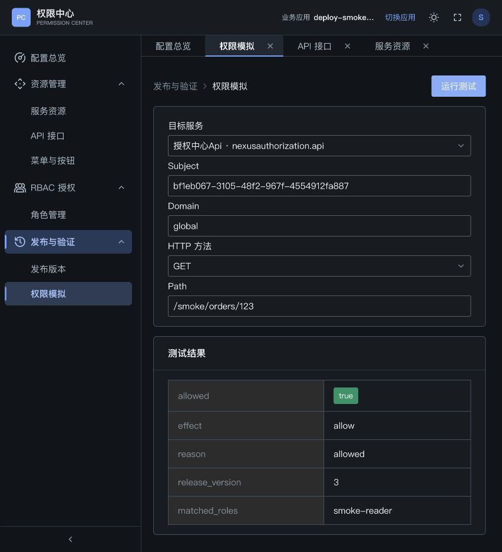

# 2026-10-14 部署前验收

本记录针对当前工作区代码。结论：本次覆盖的核心业务流程通过；发现的表单回显与停用应用编辑问题已修复。正式上线须使用本次源码构建的镜像，并在目标服务器复核 HTTPS 域名和 OIDC 回调。固定的远程 `1.0.2` 标签未核对其内容，不能作为本次代码的部署凭据。

## 环境与数据范围

- 独立 PostgreSQL 16 容器 `nexusauthorization-deploy-smoke-20261014`，本机端口 `55434`，数据库名 `nexus-authorization`。按顺序执行 `000_create_database.sql` 和 `001_init.sql`，新建完整 schema，不改已有数据库。
- 当前源码后端 `8080`、Vite 前端 `5274`。使用本机现有 `.env` 中的真实 NexusAuth OIDC、服务目录与 SCIM 配置；凭据不记录在文档中。登录由用户在浏览器完成，回调返回控制台成功。
- 独立功能验证实例仅绑定本机 `127.0.0.1:8081`，提供最终前端构建的 `5276` 也只绑定本机。其开发身份用于首次业务流程及本地服务 CRUD；这些结果与真实 OIDC 会话验证分别记录。验证结束后已停止该临时后端和代理，保留 `5274` 源码实例与 `5280` 镜像实例供复核。
- 最终 Docker 镜像：`nexusauthorization-api:smoke-20261014`、`nexusauthorization-dashboard:smoke-20261014`，均按仓库 Dockerfile 构建为 `linux/amd64`。镜像后端启用实际 OIDC，连接同一独立验收库；Nginx 前端仅映射 `127.0.0.1:5280`。两个容器健康检查通过。
- 应用 `deploy-smoke-20261014` 用于远程目录、菜单、角色和发布验收，保留供复核；最终启用，当前发布 v3。`deploy-local-20261014` 用于本地服务验收；临时服务及临时子菜单已删除。
- 远程身份目录仅执行查询，不新建用户、不修改远程用户或服务。用户角色绑定及发布均只写独立验收库。

## 真实浏览器操作

浏览器操作没有拦截或 mock `/api`。首次流程使用最终前端构建连接真实 Go 后端；用户登录后又在真实 OIDC 会话中验证编辑、目录、发布、菜单和模拟；最后通过 Nginx 镜像再执行模拟。

| 流程 | 实际结果 |
| --- | --- |
| 统一登录 | 跳转真实 NexusAuth，用户登录后经后端回调返回控制台；管理请求带会话成功 |
| 创建和选择应用 | 新应用保存成功，应用名称、标识、描述和 URL 持久化；默认启用；进入权限配置成功 |
| 编辑、停用及恢复应用 | 原值回显正确；应用标识锁定；停用后不能进入；可编辑并重新启用 |
| 远程服务目录 | 真实目录查询成功，显示 3 个服务；只读，不显示本地 CRUD 操作 |
| 关联服务 | 关联 `nexusauthorization.api` 成功，能从服务行进入 API 列表 |
| 新增、编辑和筛选 API | 新建 `GET /smoke/orders/{id}`，编辑摘要成功；筛选结果正确；其它字段保留 |
| Swagger 导入 | 从当前后端 `/swagger/openapi.json` 导入，总计 39、新增 39、跳过 0；目录合计 40 条，未自动授予角色 |
| 菜单及按钮 | 创建菜单、子按钮与临时子菜单；编辑回显正确；上级选择标识按钮不可作为上级、自身不可选；临时叶菜单删除成功 |
| 角色授权 | `smoke-reader` 授予 1 个菜单、1 个按钮、1 个 API；勾选按钮补齐祖先；保存及编辑回显成功 |
| SCIM 用户分配 | 真实用户列表加载成功；选中用户并保存；在真实登录会话重新打开能看到原绑定 |
| 发布历史 | v1、v2、v3 发布成功；只有最新版本为当前发布，旧版本显示已替代 |
| 权限模拟 | 已绑定用户允许，陌生用户拒绝；默认服务、`global` 和 `GET` 正确显示 |
| 草稿与发布隔离 | v1 允许；移除角色草稿 API 授权后仍按 v1 允许；发布 v2 后拒绝；恢复授权并发布 v3 后允许 |
| 服务关联保护 | 角色仍授权服务 API 时取消关联返回 409，原关联保留；修复后页面保留后端失败原因 |
| 本地服务 CRUD | 新建、编辑描述、关联成功；已关联时删除入口禁用；取消关联后确认删除成功 |
| 镜像与代理 | Nginx 镜像加载应用、路由及会话成功，模拟通过真实容器后端返回 `allowed=true`、v3 |

最终镜像的真实鉴权截图：

## 运行时接口与保护

直接请求真实 OIDC 后端 `/v1/authorize`，使用独立验收服务凭据，结果如下。拒绝决策仍是 HTTP 200，认证错误是 HTTP 401，符合当前契约。

| 请求 | HTTP | 结果 |
| --- | --- | --- |
| 已绑定 subject，GET `/smoke/orders/123` | 200 | `allowed=true`、`reason=allowed`、v3 |
| 未绑定 subject | 200 | `allowed=false`、`endpoint_not_granted` |
| 未登记的路径 | 200 | `allowed=false`、`endpoint_not_found` |
| 未登记的 POST 方法 | 200 | `allowed=false`、`endpoint_not_found` |
| 缺失 / 错误的服务凭据 | 401 | `authentication required` |
| 未登录访问 `/v1/applications`、`/v1/users` | 401 | 拒绝读取管理数据 |
| 应用停用后请求原授权路径 | 404 | 立即拒绝，无需重新发布；恢复启用后 v3 重新允许 |

## 验收中修复的问题

1. 停用应用卡片的 `aria-disabled` 影响内部编辑按钮。停用卡片改为普通分组，选择入口仍禁用，编辑可用。
2. TDesign FormItem 覆盖外部受控输入值，导致应用、API 和本地服务编辑回显为空，部分开关显示错误，模拟默认值不可见。对外部受控字段使用 Fragment 保留其状态；菜单、角色筛选等由 Form 自身管理的字段继续使用原方式。
3. 服务关联失败提示原本固定为“请重试”，现在保留后端原因，能识别角色 API 授权冲突。
4. 生产 `.env.example` 的可选 SCIM 地址原本非空但凭据为空，直接使用会触发配置校验。现在默认两者都为空；使用 SCIM 时成对填写。

## 删除项与自动化验证

- 删除的前端模块、图标和导出无存活引用，构建 glob 不指向删除目录。删除的旧后端 handler 原本未注册，旧仓储和模型无运行调用；必要测试辅助目标保留。详细清单见 [实现对照与清理](implementation-alignment.md)。
- 清理前基线的 58 个既有测试路径全部存在；28 个软链接有效；既有实际测试文件内容未变。没有通过删除或改写旧断言获取通过结果。
- Go 后端 `go test ./...`、`go vet ./...` 与 SDK 测试通过。
- 在本次刚初始化的独立库实际执行 5 个 PostgreSQL 集成测试，通过；包括菜单并发子场景和兼容 API 目录测试。
- 最终前端 `npm run build` 通过；仍有既有的产物体积警告。
- 当前流程 E2E：原 48 项加 4 个新增回归用例，共 **52 项通过（26.6 秒）**。这些自动化用例 mock 管理 API，与上面的真实浏览器验证分别统计。
- 原 `nexus-authorization.spec.ts` 的 23 项历史用例仍保留。此前全量运行这些用例失败，因仍预期旧服务选择和策略流程；本次最终运行排除这个明确的历史分组，因此不记为全量 E2E 通过。“原样保留”属于清理阶段的原则，指不删测试、不改断言以规避失败；本轮命名同步仅改文件名和 fixture 路径，断言业务逻辑未变。

## 正式上线前

1. 使用最终源码和最终 `dashboard/dist` 构建前后端镜像；配置实际发布的新标签。当前两个 Compose 只使用固定 `image`，不会自动构建当前工作区。
2. 将本次新增源码、完整初始化 SQL 和 `init-db.sh` 包含在发布内容中；从 Git 部署时先提交完整改动。真实 `.env` 不提交。
3. 新服务器先创建 `nexus-authorization` 空库，再由库拥有者执行完整 `001_init.sql`；不要对已有数据卷重跑首次初始化或直接改名。
4. 在目标 HTTPS 入口验证真实域名的登录、回调、退出、Cookie、远程目录及业务服务凭据。本次真实登录回调使用 `localhost:8080`，容器前端复用了同 hostname 的已登录会话，未代替生产域名回调验证。
5. 历史测试的迁移另行处理。本次保留原用例与失败事实，不把它们当作本次功能回归通过；保留指不删测试、不改断言，本轮命名同步也只同步名称与 fixture 路径。

构建与部署命令见 [Docker 部署](docker-deployment-1.0.2.md)，管理员操作见 [标准使用手册](user-guide.md)。

## 本轮命名同步复核（2026-10-14）

本轮确认旧品牌标识已统一为 `nexus-authorization`，覆盖文档、示例、后端 Go 模块（`github.com/luck/nexus-authorization`）、SDK 模块（`github.com/luck/nexus-authorization/sdk`）、页面目录、E2E 文件名，以及 Swagger 与管理端会话 Cookie（`nexusauthorization_session`）。

- 后端 `go test`、`go vet` 与 SDK 测试通过。
- 前端 `npm run build` 通过。
- 当前工作台分组 52 项在 `--timeout=60000` 下全量重跑通过；冷启动首次出现的 4 项超时已复跑通过。
- 历史 23 项用例保留，仅同步文件名和 fixture 路径，断言业务逻辑未改变，不删除用例、不改变断言结果；仍沿用清理阶段记录的失败事实，不计入本轮通过结论。
- 按仓库 Dockerfile 构建出本地 linux/amd64 镜像 `nexus-authorization-api:rename-20261014` 和 `nexus-authorization-dashboard:rename-20261014`，未推送、未启动真实部署，因此不代表生产部署验证。
- 命名切换后已有会话失效，部署时须使用本轮新镜像，并重新登录、重新选择业务应用；Compose 固定标签不会自动包含本次改动。
