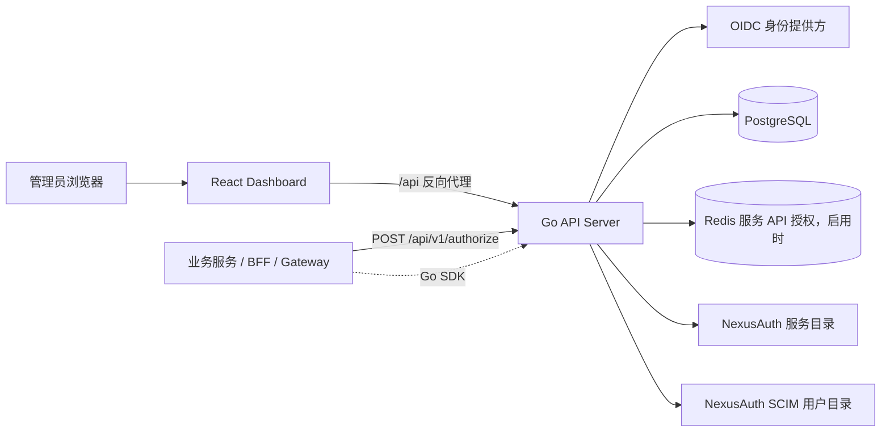
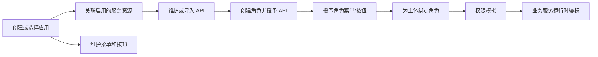

# NexusAuthorization 系统设计说明

整理日期：2026-10-16。本文以当前工作区代码、`migrations/001_init.sql`、Docker 配置和现有测试为准，描述已经实现的系统行为。文中明确标记的限制不属于当前版本能力承诺。

## 1. 系统定位

NexusAuthorization 是按业务应用隔离权限边界的授权中心，负责维护服务资源目录、API 端点、菜单与按钮、角色以及主体角色绑定，并为业务服务提供运行时授权判断。

系统把“管理配置”和“运行时决策”放在同一个权限模型中：管理端保存成功后，数据在事务提交时直接生效；业务服务下一次调用鉴权接口时读取当前配置，不需要发布、审批或切换版本。

当前版本覆盖：

- 业务应用级隔离；
- 服务资源与 API 共享目录；
- 应用内角色、菜单、按钮和主体角色绑定；
- OIDC 管理端登录；
- NexusAuth 服务目录和 SCIM 用户目录接入；
- PostgreSQL 持久化业务配置；服务 API 授权默认以 Redis 为准，显式禁用后使用数据库 current-policy；
- Go SDK 和 HTTP 鉴权接口；
- Swagger/OpenAPI API 目录导入。

当前版本不包含显式 deny 策略、ABAC、数据行级权限、组织架构、用户组、策略审批、发布版本、历史快照和权限回滚。

## 2. 总体架构



组件职责如下：

| 组件 | 职责 | 状态管理 |
| --- | --- | --- |
| Dashboard | 登录后的应用选择、资源配置、角色编辑、用户分配和权限模拟 | 浏览器 session/local storage 保存页面状态；权限数据由 API 提供 |
| API Server | 认证、管理 API、授权决策、目录适配、事务边界和错误映射 | 无状态进程；会话密钥和数据库由外部存储提供，Redis 启用时再连接 Redis |
| PostgreSQL | 业务配置、约束和业务保护触发器 | 业务配置的唯一事实来源；Redis 禁用时也是服务 API current-policy 鉴权的数据来源；不保存缓存标记、revision 或发布历史 |
| Redis | 启用模式下按 `service + subject + domain` 保存共享业务 Hash，应用 key 是 field；每个应用另有 `rbac:api:app` 元数据 | 仅在 `redis.enabled=true` 时使用；应用未 ready 或 field 缺失时拒绝，不回源数据库 |
| OIDC Provider | 管理端登录、用户身份和会话上游 | 外部身份系统 |
| Service Catalog | 服务资源目录 | local 模式使用本地表；nexusauth 模式从远程目录读取 |
| SCIM Directory | 管理端用户搜索和分页 | 用户资料不落库 |
| SDK | 业务服务内的失败关闭中间件和直接调用封装 | 不保存授权状态 |

API Server 通过 `src/internal/app/app.go` 完成装配，入口在 `src/cmd/api-server/main.go`。Dashboard 部署镜像由 Nginx 托管静态文件，将 `/api` 前缀转发到 API Server，并单独将 OIDC 回调 `/signin-oidc` 转发到 API Server。

## 3. 权限模型

应用是隔离边界，服务资源是可跨应用复用的 API 目录。应用关联服务只建立目录使用关系，不直接授予权限。

```text
Application
├── ApplicationServiceResource -> ServiceResource
├── Menu / Button
├── Role
│   ├── RoleApiEndpointBinding -> ApiEndpoint
│   └── RoleMenuBinding -> Menu / Button
└── SubjectRoleBinding(subject, domain) -> Role
```

运行时输入为：

```text
appKey + serviceResource + subject + [domain] + method + path
```

决策过程按以下顺序执行：

1. 查找并确认应用处于启用状态。
2. 确认服务资源在应用的当前关联集合中，且目录中仍然有效。
3. 按 `subject + domain` 查找主体绑定的启用角色。
4. 在指定服务和 HTTP 方法下匹配 API 路径。
5. 判断匹配的 API 是否被主体角色授予。
6. 返回 `allowed`、`effect`、`reason` 和命中的角色编码。

默认域用空字符串表示。省略、空白和兼容值 `global` 会归一为默认域；具名域保持独立。固定路径优先于参数路径，参数路径只匹配一个非空路径段，不提供任意深度通配符。

## 4. 管理配置流程



管理 API 位于 `/api/v1` 下，除 `/api/v1/authorize` 外默认受 OIDC 会话或 Bearer 管理令牌保护。RBAC v1 管理接口都要求 `app_key`；接口端点的创建、更新、导入和删除还需要 `service_resource`，且服务必须已经关联当前应用。

保存角色时，仓储层在同一个事务中校验角色、API、菜单和应用边界，并更新授权集合。主体角色替换接口按 `subject + domain` 原子替换完整角色集合，调用方需要提交希望保留的全部角色。

## 5. 数据设计

核心表包括：

| 表 | 作用 |
| --- | --- |
| `applications` | 业务应用 |
| `service_resources` | local 服务目录元数据 |
| `application_service_resources` | 应用与服务的关联 |
| `api_endpoints` | RBAC v1 共享 API 目录 |
| `roles` | 应用内角色 |
| `menus` | 应用菜单、按钮和目录节点 |
| `role_api_endpoint_bindings` | 角色到 API 的授权 |
| `role_menu_bindings` | 角色到菜单/按钮的授权 |
| `subject_role_bindings` | 主体、域与角色的绑定 |

数据库约束和仓储校验共同保证：应用内角色编码唯一，服务内接口组合唯一，角色与菜单不跨应用，角色只能授予应用已关联服务的 API，菜单父子关系不跨应用，按钮不能作为父节点。

数据库只保存业务配置，没有 `applications.policy_token`、角色/服务 revision 或发布历史。`001_init.sql` 只创建四条业务保护触发器：禁止停用有关联的服务资源、禁止解除仍有 API 授权的服务关联、禁止跨应用角色 API 授权、禁止跨应用角色菜单授权。Redis 模式下，一致性不依赖数据库标记，而由控制面在保存后重建 Redis 记录，详见下节。

完整字段、约束和触发器说明见 [当前数据库结构](current-database-schema.md)。

## 6. 运行时授权与缓存

`redis.enabled` 默认 `true`，省略 YAML 时也为 `true`。启用时，运行时服务 API 授权（`POST /api/v1/authorize` 和 `POST /api/v1/rbac-v1/simulate`）直接以 Redis 为来源。同一 `service + subject + normalized domain` 共用业务 Hash，key 为 `PREFIX:<QueryEscape(trim(service))>:<QueryEscape(trim(subject))>[:<QueryEscape(normalized domain)>]`；`trim(app_key)` 是 field 名，field value 是普通 `SubjectAPIPolicy` JSON。应用没有业务 key 段；空域和 `global` 不追加 domain 后缀，具名域分别使用独立 Hash。每个 field value 上限 16 MiB，Hash 不设 TTL。

应用级 `state`、`members`、`lock`、`requested` 和 `published` 全部位于 `PREFIX:rbac:api:app:<QueryEscape(trim(app_key))>:*`。鉴权请求用一次 Lua 原子读取内部 `state` 和目标 field：返回码 `1` 表示 field 存在，`2` 表示应用 ready 但 field 缺失，`0` 表示应用未发布，`-1` 表示应用未 ready。只有 `1` 才校验身份、大小和 JSON，再按内容哈希复用进程内编译索引（默认上限 1024 条，并发加载用 30 秒 singleflight 合并）；`2` 返回正常 deny，`0`、`-1`、身份不匹配、损坏、超时或 Redis 不可用都失败关闭。启用模式要求启动时 `redis.url` 非空。

管理端保存业务表后，控制面同步重建受影响应用的 field：先把该应用内部 `state` 置为 `updating`，依据旧 `members` 只对本应用已移除的身份执行 `HDEL`，再分批对本应用新增或变化的身份执行 `HSET`（每批最多 64 条），全部写完后置为 `ready`；任何一步失败都保持 `updating`，期间并发鉴权持续拒绝。撤权只影响当前应用 field，不删除共享 Hash 中其他应用字段。服务资源变更重建所有关联该服务的应用。

显式设置 `redis.enabled: false` 或 `NEXUSAUTHORIZATION_REDIS_ENABLED=false` 时，服务 API 使用数据库 current-policy 鉴权，不创建 Redis 客户端，也不发布 Redis 记录。开关在重启后生效；重新启用时，先设置 `redis.enabled=true` 或 `NEXUSAUTHORIZATION_REDIS_ENABLED=true` 并重启 API，再在向该实例发送服务 API 流量前保存受影响的应用、服务、角色或绑定以触发重建；禁用期间修改的权限不会自动进入旧 Redis 记录。

菜单、全策略适配器和历史基准走独立的 current-policy 路径，不读取服务 API Redis 记录：每次请求在一条 MVCC 语句里读取当前规范化业务表，计算内容 SHA-256，进程内按应用复用编译索引（默认上限 64 条）。无论 Redis 开关如何，该路径都按数据库工作。应用级索引包含：

- 按 `service + method` 分组的路由集合；
- 固定路径的哈希查找；
- 参数路径的 Trie；
- 应用内角色的稀疏位图；
- `subject + domain` 到角色位图的索引。

应用级索引只服务于当前应用和当前服务目录摘要；保存提交后新的内容 token 使旧索引失效。Redis 模式的服务 API 索引只编译该服务的 Catalog 与用户 API 并集，并随目标 Hash field value 变化失效。Redis 保存路径按应用展开 `subject × domain × service` field，空间随绑定与服务数量增长。Redis 模式下要求 Redis 可用：不可用或不 ready 时直接拒绝，不回源；Redis 禁用时服务 API 使用数据库 current-policy。菜单 current-policy 路径始终不依赖 Redis。

详细匹配规则和基准见 [鉴权匹配与性能](authorization-matching.md) 与 [Redis 接入说明](redis-integration.md)。

## 7. 认证与安全边界

管理端登录使用 OIDC。启用 OIDC 时必须配置 HTTPS 回调地址、OIDC client secret、会话密钥持久化目录和反向代理的 cookie 转发。

运行时 `/api/v1/authorize` 使用服务到服务 Bearer 凭证，不使用管理端浏览器 cookie。当前代码保留 `authorization.service_credential` 兼容校验；默认 Compose 未配置该凭证时，运行时鉴权接口保持关闭，等待统一 Open API Token 管理接入。

业务服务必须把 `appKey` 和 `serviceResource` 作为可信部署配置，把 `subject` 从已验证的身份上下文解析出来。不能从查询参数、请求体中的角色字段或用户可控 Header 推断授权身份。SDK 的 `Require` 在身份缺失、远程错误、非法决策和 deny 时均不调用下游处理器。

管理端 API 的错误返回统一为 `success / errorCode / errorMessage / result`；运行时鉴权成功时返回原始决策对象，认证失败返回 `401`。健康检查 `/api/healthz` 只表示 HTTP 进程存活，不代表数据库、OIDC、SCIM 或远程目录均可用。

## 8. 一致性与失败语义

- PostgreSQL 事务提交前的写入不会对新请求可见；提交成功后配置立即生效。
- Redis 模式下事务回滚时不重建 Redis，服务 API 记录保持上一份一致状态；禁用模式不执行 Redis 重建。
- 已经读到旧记录的在途请求可能完成旧判断；保存后的重建在下一次鉴权即可见。
- Redis 模式下，角色 API 授权、接口目录、用户角色和角色启停提交后触发受影响应用的 field 重建；替换期间内部 `state=updating`，并发鉴权直接拒绝，不会读到半写集合，也不会删除其他应用 field。
- Redis 模式下服务 API 鉴权只读 Redis，目标 field 缺失或应用不 ready 时拒绝，不回源数据库；显式禁用后使用数据库 current-policy。
- 目录读取失败时不能用无法验证的旧服务目录放行请求。
- Swagger 导入逐条写入，不是整批原子事务；中途失败时已成功写入的端点会保留，重试会跳过已存在的 `method + path_template`。
- 删除服务资源、取消应用服务关联、删除有子节点菜单等操作在引用未清理时返回冲突。
- SCIM 只影响用户搜索和分配界面；SCIM 不可用不会删除数据库中已有的主体绑定。

## 9. 可扩展点

二次开发优先沿以下边界扩展：

1. 在 `internal/biz` 增加业务规则，在 `internal/data/db/repo` 增加持久化，不要在 HTTP Handler 中直接写 SQL。
2. 新增管理接口时同步更新路由、统一错误映射、Swagger 文档、前端 API 封装和接口测试。
3. 新增权限维度时同时设计数据库约束、current-policy 策略编译、Redis 启用时的 Hash field 与应用元数据重建、模拟接口和 SDK 输入，避免只改管理端表单。
4. 新增外部目录时实现 `ServiceResourceCatalog` 或独立客户端，并在启动配置校验阶段失败，而不是在运行时静默降级。
5. 新增数据库字段或约束时先修改完整初始 schema，并在独立 PostgreSQL 空库上验证初始化结果。

## 10. 已知限制

- 当前默认 `/api/v1/authorize` 没有配置服务凭证，统一 Open API Token 管理接入前需要按部署环境配置服务到服务认证。
- Dashboard 的权限中心侧栏是前端内置导航；它与业务应用的菜单资源是两套数据。
- 用户资料和组织关系由 NexusAuth 管理，权限中心只保存主体字符串和域。
- Redis 模式的服务 API 授权 field 在保存时按应用展开 `主体 × 域 × 服务`，角色成员很多时会产生 Redis 空间开销；Hash key 可跨应用共享，但权限位图仍按应用隔离。
- 没有审计事件查询页面、策略版本、审批和回滚。
- 健康检查是存活检查，不是完整依赖探针。

配套的配置、接口和操作入口见 [文档索引](README.md)。
