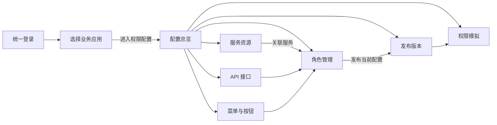
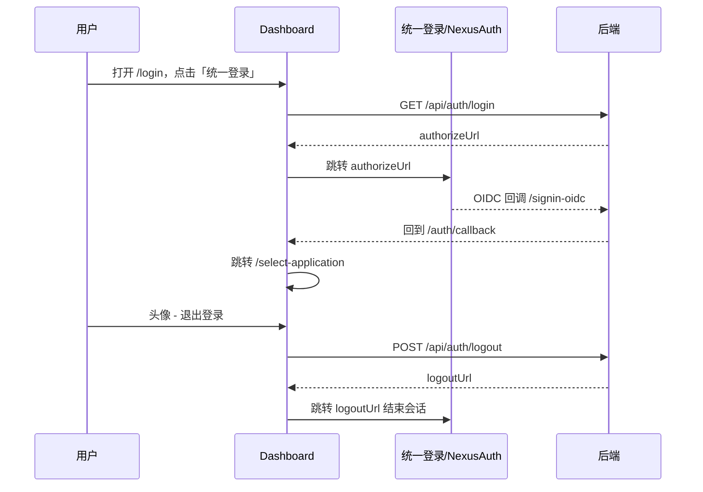

# 权限中心 UI 设计约束

本文档描述当前 dashboard 前端实现已经落地的界面、标签、路由和行为，作为 UI 约束与验收依据，而不是尚未实现的规划。文中提到的按钮文案、页面标题和路由均以源码为准；代码位置仅作为内部证据，方便核对实现。

标准操作步骤面向最终用户，见 [使用手册](user-guide.md)；前端工程与构建见 [前端开发说明](frontend-development.md)。

## 设计基线

界面复用 `dashboard/src/main.css` 的主题变量：浅色页面底色 `--app-page`（`#f4f6f8`），容器 `--app-surface`（`#ffffff`），主操作色 `--app-accent`（`#2563eb`），文本三级色、边框、表格、成功/警告/危险色都通过 `--app-*` 与 `--td-*` 变量映射到 TDesign。深色模式仅切换 `html[theme-mode='dark']` 下的同名变量，组件不单独写死颜色。

字体与控件密度由变量统一收紧：正文 15px、次级 13px、大号 17px。桌面基准视口 1440px，窄屏断点 640px；窄屏下侧栏收为 56px 图标栏、抽屉基本满屏。

主题选择写入 `localStorage` 的 `theme-mode`，并在首屏渲染前应用到 `document.documentElement`（`dashboard/src/theme.ts`、`dashboard/src/main.tsx`）。

## 整体布局

登录后进入单一工作台外壳，结构固定（`dashboard/src/layouts/layout/index.tsx`）：

1. 顶部 Header：左侧品牌区，右侧为「业务应用」当前值 + 「切换应用」按钮、主题切换按钮、全屏按钮，最右为用户头像下拉。
2. 左侧 Aside：工作台菜单，底部有「收起导航 / 展开导航」按钮，桌面展开宽 240px、收起 64px，窄屏 56px。
3. 内容区：顶部为页签（Tabs），下方为页面内容。

Header 的「业务应用」显示当前应用标识，未选择时显示「未选择」；「切换应用」跳转 `/select-application?redirect=<当前地址>`（`dashboard/src/layouts/layout/header/index.tsx`）。

头像下拉包含三项：账号设置（新窗口打开 `{authority}/account`）、当前用户名、退出登录（`dashboard/src/layouts/layout/avatar/index.tsx`）。

页签以 `pathname` 为值，默认固定「配置总览」`/dashboard` 不可关闭，其余页签可关闭；页签集合保存在 `localStorage` 的 `nexus-authorization-layout-tabs`，退出登录时清空（`dashboard/src/layouts/layout/tab-storage.ts`）。

## 导航模型约束

工作台侧栏、面包屑、页签标题共享一份菜单数据。当前这份数据由前端函数 `getMenuList()` 提供（`dashboard/src/api/auth.ts`），不发起 HTTP 请求；`RootRouterProvider` 加载一次后按 `parentId` 构建任意层级树，再按 `componentPath` 映射到已打包页面并注册 React Router 路由（`dashboard/src/router/provider.tsx`、`dashboard/src/router/workbench-menu.ts`）。

- 分组节点：`show: true` 且 `componentPath: null`，只作为侧栏分组，不注册页面。
- 可见页面：`show: true` 且带 `componentPath`，出现在侧栏。
- 隐藏页面：`show: false` 的页面仍注册路由，但不进入侧栏，例如「新增角色」「编辑角色」。
- 侧栏、标签与面包屑都取同一批数据，改动侧栏名称应改这里，而不是页面。

当前可见页面共 7 个：配置总览 `/dashboard`；资源管理分组下的服务资源 `/service-resources`、API 接口 `/api-resources`、菜单与按钮 `/menus`；RBAC 授权分组下的角色管理 `/roles`；发布与验证分组下的发布版本 `/releases`、权限模拟 `/simulate`。

发布与模拟入口在当前实现中真实存在：`/releases` 与 `/simulate` 是可见菜单项，并分别渲染「发布与版本」和「权限模拟」页面（`dashboard/src/pages/policy-workbench/index.tsx`）。因此文档和验收不应把它们描述为“仅能通过 API 操作”。旧的“用户授权 / 用户角色绑定”独立菜单已不存在，`/bindings` 会重定向到 `/roles`，用户分配在角色管理中进行（`dashboard/src/router/routes.tsx`）。

页面按 `pathname` 分派（`dashboard/src/pages/policy-workbench/index.tsx`）：`/service-resources`、`/api-resources`、`/menus`、`/roles`、`/releases`、`/simulate`，以 `/roles/` 开头的进入角色编辑器，其余落入配置总览。

## 选择业务应用页

路由 `/select-application`，页面标题「选择业务应用」，是进入管理前的前置页（`dashboard/src/pages/select-service-resource/index.tsx`）。旧路径 `/select-service-resource` 重定向到该页。

页面元素与真实文案：

- 顶栏品牌「权限中心」+ 主题切换按钮。
- 标题「选择业务应用」，副标题「选择应用，管理它的服务资源、菜单和角色权限。」，右上「新建应用」按钮。
- 搜索框占位符「搜索应用名称或标识」；统计「全部」与「启用」。
- 应用卡片网格：卡片头部为单选按钮 + 应用名称（`displayName` 优先，否则回退 `key`），正文显示应用标识与描述（空描述显示「尚未填写应用描述」），底部显示状态标签「已启用 / 已停用」，以及「编辑」按钮；仅当应用已启用且地址有效时显示「打开应用」新标签链接。
- 底部选择条：显示「已选择：<应用名>」或「请选择一个业务应用」，以及「进入权限配置」按钮。

「新建应用 / 编辑应用」使用右侧抽屉，字段与约束固定：

| 字段 | 标签 | 约束 |
| --- | --- | --- |
| 应用名称 | 应用名称 | 必填 |
| 应用标识 | 应用标识 | 必填；创建时需全局唯一；编辑时禁用不可改 |
| 应用地址 | 应用地址 | 选填；仅 `http/https`、无内嵌用户名密码、长度上限 2048 |
| 应用描述 | 应用描述 | 选填 |
| 启用 | 启用应用 | 停用后不可进入，仍可编辑和重新启用 |

创建调用 `POST /v1/applications`，编辑调用 `PUT /v1/applications/{key}`；停用与重新启用通过编辑抽屉中的「启用应用」开关完成，卡片上没有独立的启停按钮，也没有删除应用的入口（`dashboard/src/api/application.ts`）。

「进入权限配置」把所选应用写入会话存储（`sessionStorage` 键 `nexus-authorization-application`），随后跳转到 `redirect` 指定的地址或默认 `/dashboard`。当前应用是会话级状态：刷新保留，关闭标签页后失效。

## 工作台页面约束

### 配置总览

标题「应用权限总览」。上方为四步说明（关联服务 / 配置角色 / 绑定用户 / 发布验证），下方显示当前应用和四个统计：关联服务、API 接口、角色、菜单与按钮。这里只做概览，不提供编辑。

### 服务资源

标题「服务资源」（`dashboard/src/pages/policy-workbench/components/services.tsx`）。这是“应用可以使用哪些服务”的入口，与服务下的 API 目录共用。

- 顶部操作「新建服务」仅在目录可写（`writable` 且资源来源为 `local`）时出现；来自 NexusAuth 的目录为只读，页面显示「当前服务目录由 NexusAuth 提供，资源为只读。」。
- 筛选栏：关键词（服务名称、标识或 Audience）、关联状态下拉（占位「全部服务」，选项「已关联服务」）、「查询」「重置」。
- 表格列：服务名称 / 标识、Audience、状态（启用 / 停用）、应用关联（已关联 / 未关联）、操作。
- 行操作按状态变化：已关联且启用可「查看 API」（跳转 `/api-resources?service=<key>`）；本地可写资源可「编辑」「删除」；「删除」在已关联时禁用，提示先取消关联；未关联时显示「关联」，已关联时显示「取消关联」。
- 「关联 / 取消关联」通过 `PUT /v1/applications/{appKey}/service-resources` 整体替换该应用的服务集合，随后刷新。
- 新建 / 编辑服务使用抽屉，字段：服务名称（必填）、服务标识（必填，创建后不可改）、Audience、描述、启用服务。

关联服务本身只划定应用可用的 API 目录范围，不授予任何角色或用户访问权限；授权发生在角色与用户绑定两步。

### API 接口

标题「API 接口」（`dashboard/src/pages/policy-workbench/components/apis.tsx`）。展示应用可授权的接口目录。

- 顶部操作「导入 Swagger」与「新增 API」，在应用尚未关联可用服务时禁用并显示「前往关联服务」。
- 筛选栏：关键词（摘要、路径、模块或服务）、服务、方法（GET/POST/PUT/PATCH/DELETE/HEAD/OPTIONS/TRACE）、「查询」「重置」。
- 表格列：摘要 / 路径、服务、方法、模块、状态、操作（编辑、删除）。
- 新增 / 编辑抽屉字段：接口标识、摘要、目标服务（编辑时禁用）、HTTP 方法、模块、路径（必须以 `/` 开头）、启用接口。
- 导入 Swagger 抽屉字段：目标服务、Swagger URL；说明文案「导入到共享服务目录，不会自动授予应用或角色权限。」；完成后显示「总计 / 新增 / 跳过」统计。

### 菜单与按钮

标题「菜单与按钮」（`dashboard/src/pages/policy-workbench/components/menus.tsx`）。用树表管理应用的功能入口与操作权限。

- 顶部「添加」新建顶级菜单；筛选栏含关键词（名称或权限标识）、类型（全部类型 / 菜单 / 按钮）、「查询」「重置」。
- 列：名称、类型、权限标识、路由、排序、操作。菜单行操作含「编辑」「添加按钮」与「更多操作」下拉（添加子菜单、删除）；按钮行只有「编辑」「删除」。
- 分页按顶层子树分页（25/50/100），翻页不会把子节点与父节点拆开。
- 抽屉字段：资源类型（菜单 / 按钮）、名称、权限标识、上级菜单 / 所属菜单（全路径搜索的树选择）、路由与组件（仅菜单）、排序、启用开关；按钮保存文案为「保存按钮」，菜单为「保存菜单」。

前端与后端仓储共同校验层级约束，数据库另保证父子节点属于同一应用：

- 菜单可以挂在任意层级的菜单下，层级深度不设上限。
- 按钮是叶节点，必须挂在菜单下，不能再添加子级，也不能作为其它节点的上级。
- 编辑时，节点自身与其后代不能选为上级；存在子项的菜单不能改为按钮；有子项时需先处理子项再删除。
- 菜单路由填写时必须以 `/` 开头（选填）。

### 角色管理

标题「角色管理」（`dashboard/src/pages/policy-workbench/index.tsx`）。列表列：角色编码、名称、API 数、菜单数、状态、操作。

- 顶部「新增角色」跳转 `/roles/new`；行操作「编辑授权」跳转 `/roles/{id}/edit`，「分配用户」打开用户分配抽屉，「删除」弹出确认「确认删除“<角色>”及其授权和用户绑定吗？」。
- 筛选栏：关键词（名称或编码）、状态（全部状态 / 启用 / 停用）、「查询」「重置」，每页 25 条。

### 角色编辑器

路由 `/roles/new` 与 `/roles/:roleId/edit`，标题区显示「新增角色」或「编辑授权」（`dashboard/src/pages/policy-workbench/components/role-editor.tsx`）。

- 角色信息：角色名称、角色编码（编辑时禁用）、「角色启用」开关、说明。
- 授权分两个标签页：「菜单与按钮 · N」与「API 接口 · N」。
- 菜单与按钮页：左侧权限树可展开、搜索、聚焦分支；右侧为当前节点，可切换「允许访问此菜单」，列出子菜单入口，以及「本节点直接按钮」的按钮卡片，并可「选择本节点全部按钮」。勾选按钮会补齐其所有有效祖先。
- API 接口页：左侧服务列表（显示已授权数 / 总数），右侧支持按接口、模块、方法筛选、「仅看已选」与「全选当前结果」；批量勾选只作用于当前筛选结果。
- 底部显示「N 个菜单 · N 个按钮 · N 个 API」，「查看已选权限」打开复核抽屉；保存文案「保存角色」；底部提示「保存更新角色配置；发布版本后生效。」。
- 存在不可用授权（节点被删或所属服务停用 / 解除关联）时给出警告并要求先移除才能保存；移除后有可撤销提示；未保存修改离开时会弹出确认。

### 发布与版本

标题「发布与版本」，操作「发布当前配置」（`dashboard/src/pages/policy-workbench/index.tsx`）。表单填写「版本说明」，发布后列表显示版本（`vN`）、状态（当前发布 / 已替代）、说明与时间。

发布在事务内锁定应用、递增版本号并生成不可变 JSONB 快照。运行时逐次从 PostgreSQL 读取当前已发布快照。完整事务与鉴权语义见后端说明（[应用边界 RBAC 设计](rbac-v1-design.md) 与 [功能与数据模型](current-system-overview.md)）。

### 权限模拟

标题「权限模拟」，操作「运行测试」。表单字段：目标服务（仅列出已关联且启用的服务）、Subject、Domain（默认 `global`）、HTTP 方法（GET/POST/PUT/PATCH/DELETE）、Path。结果以键值对展示，布尔值用成功 / 危险标签呈现。

模拟按已发布快照判断，不评估未发布草稿；这是后端语义，前端只调用接口并展示结果。

## 授权模型：关联服务与角色授权的区别

这是本工作台最容易混淆的两件事，UI 上也分布在不同的页面：

| 概念 | 位置 | 含义 |
| --- | --- | --- |
| 关联服务 | 服务资源页的「关联 / 取消关联」 | 划定该应用可用的服务与 API 目录，本身不授予访问权限 |
| 角色授权 | 角色编辑器 | 给角色勾选具体的 API、菜单、按钮 |
| 用户绑定 | 角色管理的「分配用户」 | 把 subject + domain 绑定到一个或多个角色 |

只有三步叠加并发布后，运行时鉴权才会通过：应用必须已关联该服务，角色必须已授权目标 API，且 subject 在 domain 下拥有启用角色。

## 用户绑定与 domain 语义

「分配用户」抽屉通过 `GET /v1/users` 分页读取 NexusAuth SCIM 用户目录，选择框支持按姓名、用户名或邮箱搜索，显示格式为「姓名 · 用户名 · 邮箱」，停用用户带「已停用」。保存时只改动当前角色在该 domain 下的成员：先读取最新绑定，再合并该用户的其它角色，对变更的 subject 调用 `PUT /v1/rbac-v1/subject-roles`（`dashboard/src/pages/policy-workbench/components/role-users.tsx`）。

当前抽屉固定使用 domain `global`，界面不提供 Domain 选择。停用用户不能新增分配，但原绑定（含已从目录删除的用户）可以取消。部分用户保存失败时抽屉保持打开并显示失败数量，再次保存只重试未完成的变化。

后端仍保留 domain 字段用于按租户或组织隔离授权；此入口不修改其它 domain 的既有绑定。后端按 `app_key + subject + domain` 替换绑定集合（见 [NexusAuth SCIM 用户列表](nexusauth-scim-users.md)）。

## 登录与退出

登录页文案「欢迎回来 / 使用统一登录服务验证身份后进入权限中心」，主按钮「统一登录」。点击后调用 `GET /api/auth/login` 取 `authorizeUrl` 并跳转统一登录服务；后端完成 OIDC 回调后返回 `/auth/callback`，前端再跳转选择应用页（`dashboard/src/pages/login/index.tsx`、`dashboard/src/router/routes.tsx`）。

退出登录从头像下拉触发：先清空页签与回跳地址、清除本地登录缓存，再调用 `POST /api/auth/logout`，跳转后端返回的 `logoutUrl`，失败时回退到 `/login`（`dashboard/src/layouts/layout/avatar/index.tsx`）。

## 会话与持久化

| 状态 | 存储 | 键 / 位置 |
| --- | --- | --- |
| 当前业务应用 | sessionStorage | `nexus-authorization-application` |
| 登录回跳地址 | localStorage | `nexus-authorization-login-redirect` |
| 工作台页签 | localStorage | `nexus-authorization-layout-tabs` |
| 主题模式 | localStorage | `theme-mode` |

路由守卫按顺序判断：未登录跳转 `/login?redirect=...`；已登录但未选择应用跳转 `/select-application?redirect=...`（`dashboard/src/router/auth.tsx`）。

## 明确未实现，不默认承诺

以下内容在当前前端中没有入口，文档与验收不应将其写成已交付能力：

- 应用删除；应用地址以外的应用级配置。
- 用户授权独立菜单 / 独立页面（已合并到角色管理的「分配用户」）。
- 发布版本的差异对比、回滚 / 恢复历史版本、发布审批，以及未发布草稿的模拟入口。
- 分配用户抽屉中的 Domain 切换（当前固定 `global`）。
- 角色 - 菜单 - API 的运行时权限校验由后端负责；dashboard 侧栏来自前端 mock 导航，不承担权限校验。

## 内部证据索引

- 路由与守卫：`dashboard/src/router/routes.tsx`、`dashboard/src/router/auth.tsx`
- 导航数据与树构建：`dashboard/src/api/auth.ts`、`dashboard/src/router/workbench-menu.ts`、`dashboard/src/router/provider.tsx`
- 工作台外壳：`dashboard/src/layouts/layout/index.tsx`、`dashboard/src/layouts/layout/header/index.tsx`、`dashboard/src/layouts/layout/avatar/index.tsx`
- 选择业务应用：`dashboard/src/pages/select-service-resource/index.tsx`
- 工作台页面分派与各页：`dashboard/src/pages/policy-workbench/index.tsx` 及 `dashboard/src/pages/policy-workbench/components/*`
- API 封装：`dashboard/src/api/application.ts`、`dashboard/src/api/permission.ts`、`dashboard/src/api/rbac-v1.ts`、`dashboard/src/api/user.ts`、`dashboard/src/api/login.ts`
- 主题变量：`dashboard/src/main.css`、`dashboard/src/theme.ts`
